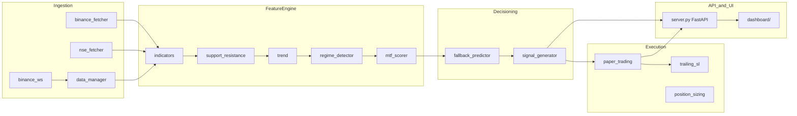
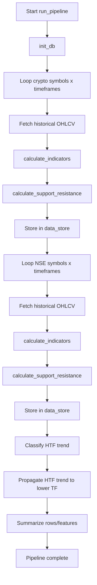
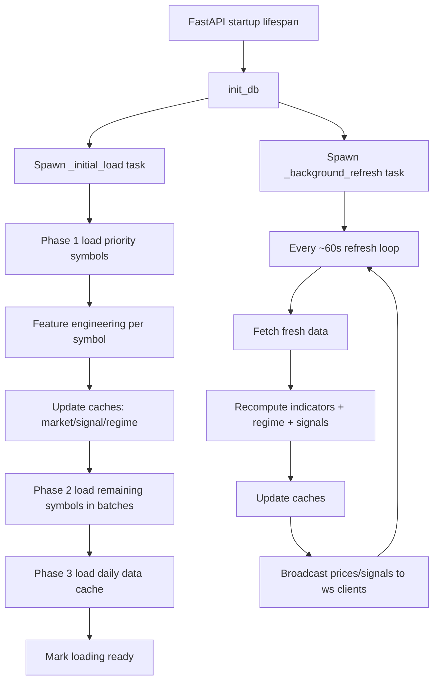
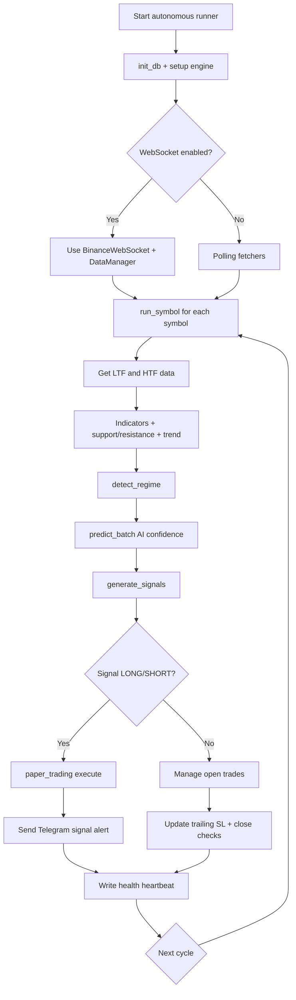
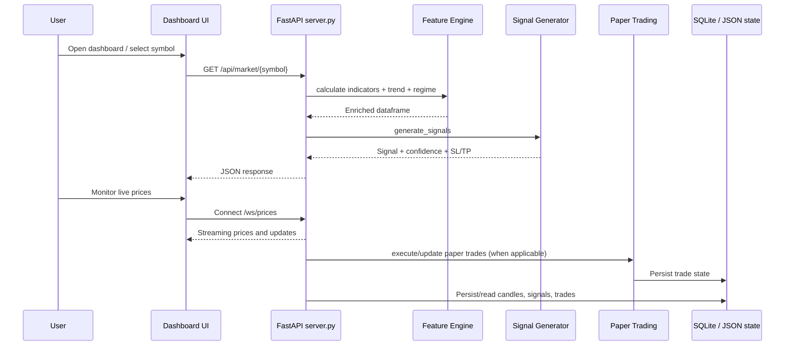

# TradeAI PRO - Architecture and Flow Diagrams

This document provides visual architecture and flow diagrams for the project.

## 1) System Architecture (High Level)

```mermaid
graph TD
    U[User / Trader] --> D[Dashboard UI<br/>dashboard/index.html + app.js]
    D -->|REST API| S[FastAPI Backend<br/>server.py]
    D -->|WebSocket| W[/ws/prices]

    S --> C1[_market_data cache]
    S --> C2[_signal_cache]
    S --> C3[_regime_cache]

    S --> DB[(SQLite<br/>trading.db)]
    S --> PT[(paper_trades.json)]
    S --> H[(health.json)]

    S --> MI[agents/market_intelligence]
    S --> FE[agents/feature_engine]
    S --> SG[agents/signal_engine]
    S --> AI[agents/ai_engine]
    S --> EX[agents/execution]
    S --> BK[agents/backtester]

    MI --> YF[yFinance / NSE feeds]
    MI --> BN[Binance / market feeds]

    AR[autonomous_runner.py] --> DI[agents/data_ingestion]
    AR --> FE
    AR --> AI
    AR --> SG
    AR --> EX
    AR --> AL[agents/alerts<br/>Telegram]
    AR --> DB
    AR --> H

    MP[main.py pipeline] --> DI
    MP --> FE
    MP --> DB
```

## 2) Core Runtime Component Map



## 3) Data Pipeline Flow (main.py)



## 4) FastAPI Background Refresh Flow (server.py)



## 5) Autonomous Trading Loop (autonomous_runner.py)



## 6) Request Flow: Dashboard to Decision



## Notes

- Main backend API and dashboard runtime: server.py + dashboard/
- Autonomous trading runtime: autonomous_runner.py
- Batch pipeline runtime: main.py
- Core domain logic lives under agents/
- Context state files: context_cache.json, news_cache.json, daily_api_usage.json
  (cache-first ingestion for 24hr + 7-day context layer)
