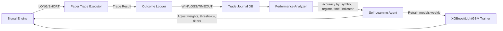

# TradeAI PRO: Bulletproof Data + Self-Learning Architecture

## Current System Analysis

After reviewing your entire pipeline, here's what you have and what's missing:

### ✅ What's Already Good
| Component | Status |
|-----------|--------|
| **Data Validation** (`validator.py`) | Solid — 6 checks (gaps, spikes, stale, duplicates, zero-vol, timezone) |
| **Multi-Model Ensemble** (`ensemble.py`) | Good — Statistical + XGBoost + LightGBM + LSTM with dynamic weights |
| **Quality Scoring** (`quality_scorer.py`) | QS gates block bad setups |
| **Fallback Predictor** | Works without PyTorch — 11 indicator confluence scoring |
| **Feature Engineering** | 45 XGBoost features (Ichimoku, Pivots, Heikin-Ashi, etc.) |

### ❌ Critical Gaps (Why Data Fails & System Doesn't Learn)

---

## PART 1: PERFECT DATA — Zero Failure Pipeline

### Problem 1: yfinance is a Single Point of Failure

Your **only** NSE data source is `yfinance`. It fails silently or returns stale data because:
- Yahoo Finance API has rate limits (can throttle after 50+ symbols)
- Weekend/holiday edge cases return empty DataFrames
- Corporate actions (splits, dividends) cause false spikes
- 5m/15m intraday history is capped at 60 days
- No local cache → every restart refetches everything

> [!CAUTION]  
> **Right now, if yfinance goes down or throttles you, your entire system produces zero signals.**

### Proposed Fix: Multi-Source Data Layer with Local Cache

```
Priority waterfall (per symbol):
  1. Local SQLite cache (< 5ms) ← fastest, always available
  2. yfinance API (< 2s)        ← current primary
  3. NSE official API (< 3s)    ← free backup for daily data
  4. Twelve Data / Alpha Vantage ← paid fallback (optional)
```

#### Key changes needed:

**a) Local OHLCV Cache Table** (in your existing `trading.db`)
```sql
CREATE TABLE IF NOT EXISTS ohlcv_cache (
    symbol     TEXT NOT NULL,
    timeframe  TEXT NOT NULL,
    timestamp  DATETIME NOT NULL,
    open       REAL, high REAL, low REAL, close REAL, volume REAL,
    source     TEXT DEFAULT 'yfinance',
    fetched_at DATETIME DEFAULT CURRENT_TIMESTAMP,
    PRIMARY KEY (symbol, timeframe, timestamp)
);
CREATE INDEX idx_ohlcv_sym_tf ON ohlcv_cache(symbol, timeframe, timestamp);
```

**Why?**
- On restart, load from cache instantly (< 100ms for 50 symbols)
- Only fetch the **delta** (new candles since last cached timestamp)
- If yfinance fails, you still have everything up to last successful fetch

**b) Incremental Fetch Logic**
```
fetch_for_symbol(symbol, timeframe):
  1. last_cached = SELECT MAX(timestamp) FROM ohlcv_cache WHERE symbol=? AND timeframe=?
  2. if last_cached is NULL → full fetch (since_days=60)
  3. else → fetch only from last_cached to now
  4. INSERT OR REPLACE new candles into cache
  5. If primary source fails → try backup source
  6. If all sources fail → use cached data + flag stale
```

**c) Corporate Action Detection**
Add this check in `validator.py`:
- If `adj_close / close` ratio changes significantly between bars → likely split
- Recalculate historical data with adjusted prices
- Log and alert on Telegram

---

### Problem 2: `SIGALRM` Timeout Doesn't Work on Windows

Your `nse_fetcher.py` uses `signal.SIGALRM` which **only works on Unix/Linux**. On Windows (your OS), this throws a runtime error.

```python
# nse_fetcher.py line 34 — THIS CRASHES ON WINDOWS
old_handler = signal.signal(signal.SIGALRM, _timeout_handler)
```

> [!WARNING]
> This means your timeout protection doesn't actually work. A stuck yfinance call can hang your entire refresh loop.

#### Fix: Use `asyncio.wait_for()` or `threading.Timer`
```python
import asyncio

async def fetch_with_timeout(symbol, timeframe, timeout_sec=15):
    loop = asyncio.get_event_loop()
    return await asyncio.wait_for(
        loop.run_in_executor(None, _sync_fetch, symbol, timeframe),
        timeout=timeout_sec
    )
```

---

### Problem 3: Background Refresh Can Miss Entire Cycles

In `server.py`, the `_background_refresh` loop runs every ~60s. If one symbol fetch takes too long, it delays ALL other symbols.

#### Fix: Parallel Symbol Fetching
```
Current:   [SYM1 fetch] → [SYM2 fetch] → ... → [SYM50 fetch]  (serial: 50×2s = 100s)
Proposed:  [SYM1] [SYM2] [SYM3] ... [SYM50]  (parallel: ~5s with rate limiting)
```
Use `asyncio.gather()` with `asyncio.Semaphore(max_concurrent=10)` to fetch 10 symbols simultaneously while respecting API rate limits.

---

### Problem 4: WebSocket Disconnects Silently

`binance_ws.py` handles reconnection, but there's no health-check heartbeat. If the WebSocket drops during market hours:
- Prices freeze at last known value
- Dashboard shows stale prices without warning
- Signals compute on stale data → garbage outputs

#### Fix: Heartbeat Monitor
```
Every 30s:
  - Check last_ws_message_time
  - If > 60s stale → attempt reconnect
  - If > 180s stale → fall back to REST polling
  - Dashboard shows "LIVE" / "DELAYED" / "OFFLINE" indicator
```

---

## PART 2: SELF-LEARNING — System That Gets Smarter

### What "Self-Learning" Means in This Context

Your system already has the *infrastructure* for learning but it's **not connected to a feedback loop**. Here's the gap:

```
Current flow:
  Signal Generated → Dashboard Shown → ??? (no follow-up)

Required flow:
  Signal Generated → Trade Executed → Outcome Tracked → 
  Score Updated → Model Retrained → Better Signals
```

### Architecture: The Feedback Loop



### Component 1: Trade Outcome Logger

You have `trade_journal.json` and `paper_trades.json` but they're **not feeding back into the system**. 

#### What to store per signal:

| Field | Purpose |
|-------|---------|
| `signal_id` | UUID for tracking |
| `symbol` | Which stock/crypto |
| `signal_type` | LONG / SHORT |
| `entry_price` | Actual entry |
| `sl_price` | Stop loss level |
| `tp_price` | Target price |
| `outcome` | WIN / LOSS / TIMEOUT |
| `pnl_pct` | Actual P&L % |
| `time_to_outcome` | How many bars to close |
| `regime_at_signal` | TRENDING / RANGING / VOLATILE |
| `rsi_at_signal` | RSI value |
| `confidence_at_signal` | What the model predicted |
| `quality_score` | QS at time of signal |
| `model_votes` | Which models agreed |
| `timestamp` | When generated |

```sql
CREATE TABLE signal_outcomes (
    id              TEXT PRIMARY KEY,
    symbol          TEXT NOT NULL,
    signal_type     TEXT NOT NULL,  -- LONG/SHORT
    entry_price     REAL,
    sl_price        REAL,
    tp_price        REAL,
    outcome         TEXT,  -- WIN/LOSS/TIMEOUT/OPEN
    pnl_pct         REAL,
    bars_to_close   INTEGER,
    regime          TEXT,
    rsi             REAL,
    confidence      REAL,
    quality_score   INTEGER,
    model_votes     TEXT,  -- JSON: {"statistical":"UP","xgboost":"UP"}
    created_at      DATETIME DEFAULT CURRENT_TIMESTAMP,
    closed_at       DATETIME
);
```

### Component 2: Performance Analyzer

Runs after each trade closes. Computes rolling stats:

```
Per-symbol accuracy:
  RELIANCE → 72% win rate over last 30 trades → boost confidence
  TCS      → 38% win rate over last 30 trades → suppress signals

Per-regime accuracy:
  TRENDING signals → 68% win rate → increase weight  
  RANGING signals  → 35% win rate → reduce or skip

Per-indicator patterns:
  "RSI < 30 + MACD bullish + TRENDING" → 78% win rate → strong pattern
  "RSI 45-55 + RANGING" → 42% win rate → garbage pattern → filter out

Per-timeframe:
  Morning (9:15-11:00) → 65% win rate → priority signals
  Afternoon (14:00-15:00) → 45% → reduce confidence by 20%
```

### Component 3: Adaptive Signal Filters

The Performance Analyzer outputs **adaptive parameters** that modify signal generation:

```python
# In signal_generator.py — add adaptive filtering
def apply_adaptive_filters(signal, perf_stats):
    """Adjust signal confidence based on historical performance."""
    
    sym_stats = perf_stats.get(signal.symbol, {})
    regime_stats = perf_stats.get(signal.regime, {})
    
    # If this symbol has poor recent history, reduce confidence
    sym_winrate = sym_stats.get('winrate_30', 0.5)
    if sym_winrate < 0.35:
        signal.confidence *= 0.7  # 30% penalty
        signal.skip_reason = f"Low win rate: {sym_winrate:.0%}"
    
    # If signals in this regime have poor history, reduce  
    regime_winrate = regime_stats.get('winrate_30', 0.5)
    if regime_winrate < 0.40:
        signal.confidence *= 0.8  # 20% penalty
    
    # Time-of-day adjustment
    hour = signal.timestamp.hour
    time_winrate = perf_stats.get(f'hour_{hour}', {}).get('winrate', 0.5)
    if time_winrate < 0.40:
        signal.confidence *= 0.85
    
    return signal
```

### Component 4: Auto-Retrain Pipeline

**When to retrain:**
- Every Sunday night (offline, before Monday market open)
- After every 100 new trade outcomes
- When performance drops below 45% win rate over 50 trades

**What to retrain:**
```
1. XGBoost model:
   - Append new labeled data to training set
   - Run Optuna tuning (30 trials)
   - Walk-forward validation
   - Only deploy if validation accuracy > previous model

2. LightGBM model:
   - Same flow as XGBoost

3. Dynamic weights (in ensemble.py):
   - Already implemented via _ModelPerformanceTracker
   - BUT: currently resets on restart → persist to DB

4. Signal thresholds:
   - Confidence min → adjust based on recent win rate
   - Quality score min → adjust based on false positive rate
```

#### Retrain Script (weekly cron job):
```
train_weekly.py:
  1. Load last 90 days of OHLCV data from ohlcv_cache
  2. Load signal_outcomes for label validation
  3. Feature engineer (45 XGBoost features)
  4. Train XGBoost with Optuna
  5. Train LightGBM with Optuna
  6. Walk-forward validation
  7. If new model > old model → deploy
  8. If new model < old model → keep old, log warning
  9. Update adaptive thresholds in config
  10. Send Telegram summary
```

### Component 5: Persist Dynamic Weights Across Restarts

Currently, `_ModelPerformanceTracker` in `ensemble.py` resets when the server restarts. This loses all learning.

```sql
CREATE TABLE model_performance (
    model_name  TEXT NOT NULL,
    predicted   TEXT NOT NULL,  -- UP/DOWN
    actual      TEXT NOT NULL,  -- UP/DOWN  
    symbol      TEXT,
    timestamp   DATETIME DEFAULT CURRENT_TIMESTAMP
);
```

On startup: load last 20 records per model → warm-start the tracker.

---

## PART 3: Implementation Phases

### Phase 1: Bulletproof Data (Week 1)
Priority: **CRITICAL** — everything else depends on reliable data

- [ ] Add `ohlcv_cache` table to `trading.db`
- [ ] Fix Windows timeout bug in `nse_fetcher.py` (replace SIGALRM)
- [ ] Implement incremental fetch (only new candles)
- [ ] Add parallel symbol fetching with semaphore
- [ ] Add WebSocket heartbeat monitor
- [ ] Persist `_ModelPerformanceTracker` to SQLite

### Phase 2: Outcome Tracking (Week 2)
Priority: **HIGH** — without tracking, no learning is possible

- [ ] Create `signal_outcomes` table
- [ ] Hook into paper trade close events → log outcome
- [ ] Build Performance Analyzer queries
- [ ] Add `/api/performance` endpoint for dashboard
- [ ] Add performance summary to dashboard UI

### Phase 3: Adaptive Filters (Week 3)
Priority: **MEDIUM** — applies learning to signal generation

- [ ] Implement `apply_adaptive_filters()` in signal engine
- [ ] Per-symbol, per-regime, per-hour win rate tracking
- [ ] Confidence adjustment based on historical performance
- [ ] Dashboard shows "Learning Status" indicator

### Phase 4: Auto-Retrain Pipeline (Week 4)
Priority: **MEDIUM** — full automation of model improvement

- [ ] Create `train_weekly.py` script
- [ ] Implement model versioning (keep last 3 models)
- [ ] Walk-forward validation gate (only deploy if better)
- [ ] Telegram notification on retrain results
- [ ] Schedule via Windows Task Scheduler or systemd

---

## Key Constraints (Indian Market Specifics)

| Factor | Impact | Mitigation |
|--------|--------|------------|
| NSE market hours 9:15-15:30 IST | No intraday data outside hours | Use 1d data for overnight signals |
| yfinance 5m/15m cap: 60 days | Can't backtest further | Cache locally, switch to 1h/1d for deeper history |
| Free tier limitations | Can't hit APIs too frequently | Local cache + delta fetching |
| Holidays (Diwali, Republic Day, etc.) | Gaps in data | Holiday calendar filter in gap detection |
| Corporate actions (bonus, split) | Fake price spikes | Adjusted close validation |

---

## Summary: What Changes Where

| File | Change |
|------|--------|
| `nse_fetcher.py` | Fix SIGALRM, add cache read/write, add backup source |
| `server.py` | Parallel refresh, incremental fetch, cache init |
| `validator.py` | Corporate action detection, holiday calendar |
| `signal_generator.py` | Add `apply_adaptive_filters()` hook |
| `ensemble.py` | Persist `_ModelPerformanceTracker` to DB |
| `autonomous_runner.py` | Log outcomes to `signal_outcomes` table |
| **NEW** `db/ohlcv_cache.py` | Local OHLCV cache CRUD operations |
| **NEW** `agents/analytics/performance.py` | Performance Analyzer (win rates, patterns) |
| **NEW** `train_weekly.py` | Automated weekly retrain script |
| **NEW** migration | `ohlcv_cache` + `signal_outcomes` + `model_performance` tables |

## Open Questions

> [!IMPORTANT]
> 1. **Budget for paid data source?** Alpha Vantage free tier gives 25 calls/day. Twelve Data free tier gives 800 calls/day. Both have NSE coverage. Worth adding as fallback?
> 2. **Auto-retrain frequency?** Weekly is safe. Daily is aggressive but can catch regime shifts faster. What's your preference?
> 3. **Which phase to start with?** I recommend Phase 1 (data reliability) first since everything else depends on it. Agree?
