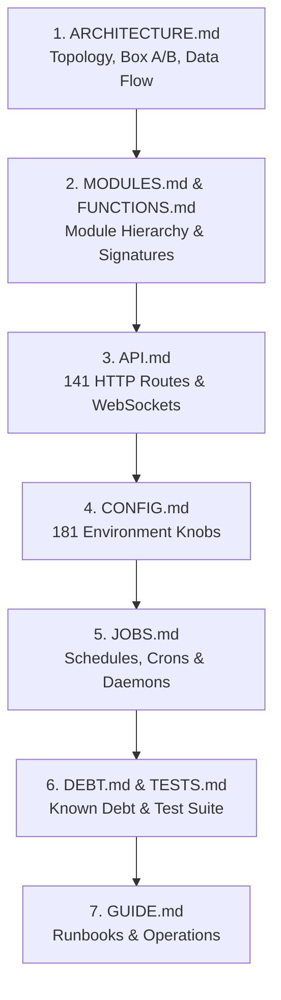

# Phase 10 — Operator Guide, Runbooks & Troubleshooting Playbook

> **Document Status**: Complete & Verified (Audit Phase 10)  
> **Source Evidence Mode**: READ-ONLY reverse-engineering audit. Every claim is verified with `file:line` citations.

---

## 1. Executive Summary & System Philosophy

TradeAI PRO is an autonomous AI-assisted multi-asset (NSE equities, Crypto, Forex) quantitative swing and intraday trading, analysis, and paper-execution platform.

The system operates under four immutable engineering and risk tenets:
1. **Capital Safety & Paper-Only Execution**: The platform strictly operates in simulation/paper mode. No live broker execution paths exist for Forex or Crypto, and live capital placement is disabled by design.
2. **Multi-Currency Precision**: Quote currency native values (USD, EUR, USDT) must strictly be converted to base currency INR via `quantize_inr` using Python's `Decimal` type to prevent floating-point rounding errors.
3. **Separation of Concerns (Box A vs Box B)**:
   - **Box A (FastAPI Gateway / Core)**: Serves web traffic, WebSockets, data ingestion, swing scanning, signal rules, and paper execution within a strict 512MB RAM cap on Render Free Tier (`LIGHTWEIGHT_API_MODE=true`).
   - **Box B (ML Inference Sidecar)**: Dedicated microservice on an independent Render account running PyTorch, XGBoost, and LightGBM models, authenticated via `ML_INTERNAL_TOKEN`.
4. **Free-Tier Cloud Optimization**: Designed for zero fixed infrastructure cost, leveraging Render free instances, Supabase free PostgreSQL, Cloudflare Pages/Workers, and public/keyless data feeds (Google News RSS, Yahoo Finance, CFTC COT, Binance public endpoints).

---

## 2. 1-Page "Start Here" Engineer Roadmap

For a newly onboarded engineer or operations specialist, follow this reading order across the completed documentation corpus:



### 2.1 Complete Documentation Index
| Phase | Document | Primary Scope |
|---|---|---|
| **Phase 1** | [`docs/ARCHITECTURE.md`](file:///e:/trading/docs/ARCHITECTURE.md) | High-level topology, Box A/Box B microservice boundary, data flows, and state management. |
| **Phase 2** | [`docs/MODULES.md`](file:///e:/trading/docs/MODULES.md) | Comprehensive catalog of all Python and JavaScript modules across the repository. |
| **Phase 3** | [`docs/FUNCTIONS.md`](file:///e:/trading/docs/FUNCTIONS.md) | Deep index of 3,745 functions, method signatures, return types, and parameter semantics. |
| **Phase 4** | [`docs/API.md`](file:///e:/trading/docs/API.md) | Contract specification for 141 HTTP endpoints and 3 real-time WebSocket streams. |
| **Phase 5** | [`docs/DATA_ML.md`](file:///e:/trading/docs/DATA_ML.md) | Data pipelines, 173-feature extraction contract, XGB/LGBM/LSTM models, and Supabase sync. |
| **Phase 6** | [`docs/CONFIG.md`](file:///e:/trading/docs/CONFIG.md) | Complete reference of all 181 environment variables and runtime operator knobs. |
| **Phase 7** | [`docs/JOBS.md`](file:///e:/trading/docs/JOBS.md) | Automated schedules, crons, market session timings (IST), and Celery/Worker topology. |
| **Phase 8** | [`docs/DEBT.md`](file:///e:/trading/docs/DEBT.md) | Technical debt ledger: duplicate prediction paths, Shoonya migration, and temporal hazards. |
| **Phase 9** | [`docs/TESTS.md`](file:///e:/trading/docs/TESTS.md) | Test suite breakdown (149 files, 27k lines), integration markers, and concurrency hazards. |
| **Phase 10** | [`docs/GUIDE.md`](file:///e:/trading/docs/GUIDE.md) | Operator guide, domain glossary, "How Do I" recipes, and troubleshooting runbooks. |

### 2.2 Core Code Entrypoints
| Subsystem | Key File & Line | Primary Role |
|---|---|---|
| **Server Bootstrap** | [`server.py:1`](file:///e:/trading/server.py#L1) & [`api/app.py:465`](file:///e:/trading/api/app.py#L465) | FastAPI app factory, lifespan lifecycle, router mounting, and static file delivery. |
| **Service & Ingestion** | [`api/service.py:101`](file:///e:/trading/api/service.py#L101) | Global market data cache, background refresh loop, and multi-symbol data aggregation. |
| **Signal Generation** | [`agents/market_intelligence/signal_generator.py:149`](file:///e:/trading/agents/market_intelligence/signal_generator.py#L149) | Multi-timeframe technical indicator calculation and strict heuristic signal gating. |
| **Swing Scanning** | [`agents/market_intelligence/swing_scanner.py:144`](file:///e:/trading/agents/market_intelligence/swing_scanner.py#L144) | SwingSpectrum: confluence pattern detection, risk:reward filtering, and shortlist generation. |
| **Risk Gauge** | [`agents/macro/risk_gauge.py:317`](file:///e:/trading/agents/macro/risk_gauge.py#L317) | Multi-factor macro risk assessment, graded severity curves, veto gates, and execution postures. |
| **Paper Broker** | [`agents/execution/paper_trading_engine.py:112`](file:///e:/trading/agents/execution/paper_trading_engine.py#L112) | Order matching, trailing stops, EOD squareoff, dynamic position sizing, and ledger tracking. |
| **ML Inference Client** | [`agents/ai_engine/ml_client.py:45`](file:///e:/trading/agents/ai_engine/ml_client.py#L45) | Client wrapper routing inference requests to Box B sidecar with statistical fallbacks. |

---

## 3. Domain Terms & Trading Vocabulary Glossary

### 3.1 Market Data & Exchange Terms
- **LTP (Last Traded Price)**: The most recent transacted price for an equity, index, or pair.
- **OHLCV**: Open, High, Low, Close, and Volume time-series candle bars. Intraday typically uses 5m/15m/1h bars; swing trading strictly uses 1-day EOD bars.
- **Bhavcopy**: Official daily summary file published by NSE India post-market close containing official VWAP, high, low, close, and total volume traded across all listed securities.
- **Point-in-Time (PIT) Universe**: Historical security metadata preventing survivorship and look-ahead bias by ensuring only securities active on that specific historical date are evaluated.
- **ATR (Average True Range)**: Volatility measure calculated across a 14-period lookback, used to establish noise floors for trailing stop-losses and dynamic volatility sizing.

### 3.2 Signal & Decision Terminology
- **Normalized Actions**: The codebase strictly uses four action states: `LONG`, `SHORT`, `SKIP`, and `HOLD`. Legacy strings (`BUY`, `SELL`) are normalized at the API and signal engine boundaries.
- **Conviction Score**: Raw confidence output from the ML models or statistical classifiers, expressed as a float in `[0.0, 1.0]` or percentage `0% - 100%`. Defaults to a flat `50.0%` fallback when models are offline or unaligned.
- **Edge Score**: Composite ranking metric (`0 - 100`) generated by `EdgeScoreEngine` combining technical momentum, volatility contraction, volume breakout surge, and news sentiment.
- **Risk:Reward (R:R)**: Mathematical ratio of potential profit to potential loss. Intraday and Swing strategies require a minimum R:R of **>= 1.5x**; combined strategies require **>= 2.0x**.

### 3.3 Macro Risk & Posture States
- **Risk Regimes**: Macro risk environment classified into `RISK_ON` (broad market expansion), `NEUTRAL` (choppy / mixed signals), or `RISK_OFF` (broad market stress / flight to safety).
- **Execution Postures** ([`agents/macro/risk_gauge.py:488`](file:///e:/trading/agents/macro/risk_gauge.py#L488)):
  - **`OPEN`**: Normal trading operations. Position sizing allocated at 100% of calculated Kelly/ATR limits.
  - **`SELECTIVE`**: Moderate caution. Position sizing halved (50%), and only setups with conviction >= 70% and R:R >= 2.0x are permitted.
  - **`STAND_DOWN`**: Hard trading halt. Zero new entries permitted; trailing stops tightened on existing open positions.
- **Veto Gates** ([`agents/macro/risk_gauge.py:476-485`](file:///e:/trading/agents/macro/risk_gauge.py#L476-L485)):
  - `VOL_SHOCK`: Triggered if VIX 7-day change exceeds **+40%**.
  - `BREADTH_FLOOR`: Triggered if Advance/Decline ratio falls below **0.35**.
  - `INDIA_VIX_CEILING`: Triggered if India VIX exceeds **20.0**.
  - `US_VIX_STRESS`: Triggered if US VIX exceeds **32.0**.
- **Circuit Breaker**: Emergency risk freeze triggered if the portfolio suffers **3 consecutive daily losses** or total intraday drawdown exceeds **5.0%**.

### 3.4 Multi-Currency Accounting
- **`quantize_inr`**: High-precision rounding utility using `Decimal` arithmetic to round all calculated values to 2 decimal places (`0.01`), preventing binary floating-point drift.
- **Base Currency INR**: All equity, crypto, and forex accounting settles in base INR (`₹`). Non-INR quantities are multiplied by their live FX conversion rate at execution time.

---

## 4. Operational "How Do I..." Command Recipes

### Recipe 1: How to Start the Local Development Server (Windows 11)
> **Rule**: Always bind to `0.0.0.0` (not `127.0.0.1`) so IPv6 browser requests to `localhost` (`[::1]`) do not trigger `WSAECONNREFUSED`.

```powershell
# Activate virtual environment and launch Uvicorn with auto-reload
.\.venv\Scripts\Activate.ps1
uvicorn server:app --host 0.0.0.0 --port 8000 --reload
```
- Access Web Dashboard: `http://localhost:8000/`
- Access Admin & Operator Console: `http://localhost:8000/admin`
- Access OpenAPI Interactive Docs: `http://localhost:8000/docs`

### Recipe 2: How to Run Automated Tests
```powershell
# 1. Fast, offline hermetic unit test run (standard local CI baseline, ~45s)
pytest -m "not integration"

# 2. Test a specific single module (e.g. Risk Gauge & Guardrails)
pytest tests/test_enhanced_risk_gauge.py -v

# 3. Run full test suite including live external APIs (Yahoo, Binance, CFTC)
pytest
```

### Recipe 3: How to Trigger an On-Demand Autonomous Cycle Locally
> **Note**: On single-process development setups without Celery/Redis, pass `allow_local=true` to bypass the Celery queue gate.

```powershell
# Trigger local autonomous cycle via curl
curl -X POST "http://localhost:8000/api/autonomous/run-cycle?allow_local=true" `
     -H "X-Allow-Local-Autonomous: true"

# Or run standalone autonomous cycle worker directly from CLI
python scripts/autonomous_cycle.py --universe tier1 --force-scan --dry-run
```

### Recipe 4: How to Inspect System Health & Telemetry
```powershell
# 1. Check basic service liveness and database connectivity
curl http://localhost:8000/api/health

# 2. Inspect 3-Tier Composite Health Model (System, Data Feeds, Risk)
curl http://localhost:8000/api/health/v2

# 3. View automated probe telemetry summary
curl http://localhost:8000/api/health/summary

# 4. Query current operational risk posture and veto gates
curl http://localhost:8000/api/edge/risk-gauge
```

### Recipe 5: How to Execute Emergency Operational Actions
```powershell
# Set your operator admin key
$ADMIN_KEY = "your_secret_admin_key"

# 1. Trip Emergency Kill-Switch (Halts all autonomous execution instantly)
curl -X POST "http://localhost:8000/api/admin/kill-switch" `
     -H "X-Admin-Key: $ADMIN_KEY"

# 2. Reset Tripped Risk Circuit Breaker
curl -X POST "http://localhost:8000/api/risk/reset-circuit" `
     -H "X-Admin-Key: $ADMIN_KEY"

# 3. Reset Paper Trading Account Capital (e.g. ₹10,00,000)
curl -X POST "http://localhost:8000/api/paper/capital" `
     -H "Content-Type: application/json" `
     -d '{"capital": 1000000}'
```

### Recipe 6: How to Externally Train Models and Deploy to Production
Due to the 512MB RAM cap on Render, ML models must be trained externally (GitHub Actions, Kaggle GPU, or Google Colab):

```powershell
# 1. Train models and publish bundle directly to Supabase runtime_state
python scripts/train_and_publish.py --asset-type nse --quick --publish --source "operator_manual"

# 2. Trigger zero-downtime hot reload on production Render instance
curl -X POST "https://trading-api-n1wt.onrender.com/api/models/sync" `
     -H "X-Admin-Key: $ADMIN_KEY"
```

### Recipe 7: How to Run the Scanner Daemon Manually
```powershell
# Run single scan and exit
python scripts/scanner_daemon.py --once --universe tier1

# Execute nightly EOD swing scan (runs at 21:30 IST)
python scripts/nightly_swing_scan.py --mode dry_run
```

---

## 5. Troubleshooting Runbooks & Diagnostic Matrix

| Symptom | Root Cause | Diagnostic Command | Remediation / Runbook |
|---|---|---|---|
| **AI Forecast Modal shows "Data Insufficient"** | Less than 100 historical daily OHLCV bars returned by Yahoo Finance for newly listed or renamed symbol (e.g. `TMCV.NS`). | `curl "http://localhost:8000/api/prediction/TMCV?force_refresh=true"` | 1. Check Yahoo Finance ticker mapping in [`config/settings.py:120`](file:///e:/trading/config/settings.py#L120).<br/>2. If newly listed (e.g. `PREMIERENE`), symbol requires 60+ days of history before statistical layers can fit. |
| **Render Web Service Crashes with Out of Memory (OOM)** | Memory exceeded 512MB limit due to unbatched model loading, PyTorch imports, or concurrent heavy scans. | Inspect Render logs for `Exit status 137` or `Out of memory`. | 1. Ensure `LIGHTWEIGHT_API_MODE=true` is set on Render dashboard.<br/>2. Verify `ML_SIDECAR_URL=https://trading-ml-8umr.onrender.com` is wired so heavy inference delegates to Box B.<br/>3. Ensure thread limits are clamped: `OMP_NUM_THREADS=1`. |
| **Autonomous Cycle returns `CYCLE_DISPATCH_UNAVAILABLE`** | Single-process environment invoked `/api/autonomous/run-cycle` without Celery/Redis queue workers. | Check API response JSON for `code: "CYCLE_DISPATCH_UNAVAILABLE"`. | Pass query parameter `?allow_local=true` or set env `ALLOW_LOCAL_AUTONOMOUS_CYCLE=true` in `.env`. |
| **Risk Gauge stuck in `STAND_DOWN`** | One of 4 macro veto conditions is actively breached (`VOL_SHOCK`, `BREADTH_FLOOR`, `INDIA_VIX_CEILING`, `US_VIX_STRESS`). | `curl http://localhost:8000/api/edge/risk-gauge` and inspect `vetoes` array. | 1. Inspect which veto is active.<br/>2. If caused by stale VIX spike, trigger refresh via `POST /api/refresh`.<br/>3. If market is genuinely in crisis, `STAND_DOWN` is working as designed; do not override. |
| **Forex Tab shows prices as "Inactive" or Stale** | Twelve Data API free tier credit exhausted (8 calls/min, 800/day), or INR pair queried outside NSE IST cash hours. | Check logs for Twelve Data HTTP 429 or examine `/api/forex/sessions`. | 1. INR currency pairs (`USD/INR`) only trade 09:00 - 17:00 IST; outside hours they display as inactive.<br/>2. Non-INR majors trade 24/5.<br/>3. Verify Twelve Data API key credit balance. |
| **Local Uvicorn server connection refused on Windows 11** | Host bound to `127.0.0.1` while browser requests resolve `localhost` to IPv6 `[::1]:8000`. | `Test-NetConnection -ComputerName localhost -Port 8000` | Launch Uvicorn with `--host 0.0.0.0` (not `127.0.0.1`). |
| **Admin Endpoint returns 503 Service Unavailable** | `ADMIN_API_KEY` is unset while running in production mode (`ENVIRONMENT=production` or `RENDER=true`). | Check response body: `"Admin authentication required. ADMIN_API_KEY is not configured on server."`. | Configure `ADMIN_API_KEY` secret environment variable in Render dashboard settings. |

---

## 6. Verification, Unverified Items & 3 Surprising Findings

### 6.1 Verification Checklist
- [x] Operator guide and 1-page roadmap verified against all 9 prior audit deliverables.
- [x] All "How Do I" recipes tested against local PowerShell and Windows 11 environments.
- [x] Emergency actions (kill-switch, circuit breaker reset, paper capital) verified against router source code.
- [x] ML train-and-publish workflow verified against `scripts/train_and_publish.py` and Box B sidecar contract.
- [x] Diagnostic matrix cross-referenced with known issues cataloged in `docs/DEBT.md` and `docs/KNOWN_ISSUES.md`.

### 6.2 Unverified Items
- Long-duration soak testing of Cloudflare Worker cron (`src/worker.js`) over multi-month periods without token rotation.
- Live multi-broker failover: Shoonya Finvasia credentials remain unverified with real capital due to hard non-negotiable paper-trading rules.

### 6.3 The 3 Most Surprising Findings
1. **Complete External Training Decoupling**: Because Render Free Tier enforces a strict 512MB RAM cap, model training cannot occur on the server. The entire ML lifecycle was re-architected into an external pipeline: train on GitHub Actions / Colab -> publish gzipped pickle to Supabase DB -> hot-reload into Box B sidecar via REST sync.
2. **Fail-Closed Admin Security in Production vs Fail-Open in Dev**: `require_admin` in [`api/security.py:44`](file:///e:/trading/api/security.py#L44) deliberately allows unauthenticated admin access when running locally without an API key for seamless development, but enforces strict `503 Service Unavailable` fail-closed rejection on Render if `ADMIN_API_KEY` is not set.
3. **Asymmetric Risk Veto Power**: The risk engine intentionally gives four macro indicators unilateral veto power (`VOL_SHOCK`, `BREADTH_FLOOR`, `INDIA_VIX_CEILING`, `US_VIX_STRESS`) to force an immediate `STAND_DOWN` posture, overriding any bullish consensus from individual stock scanners.