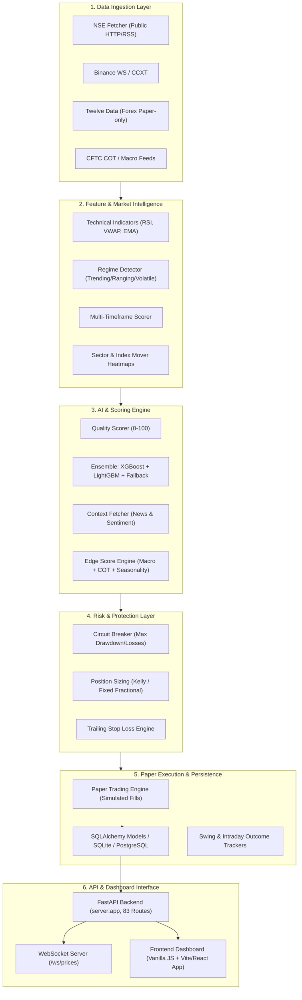
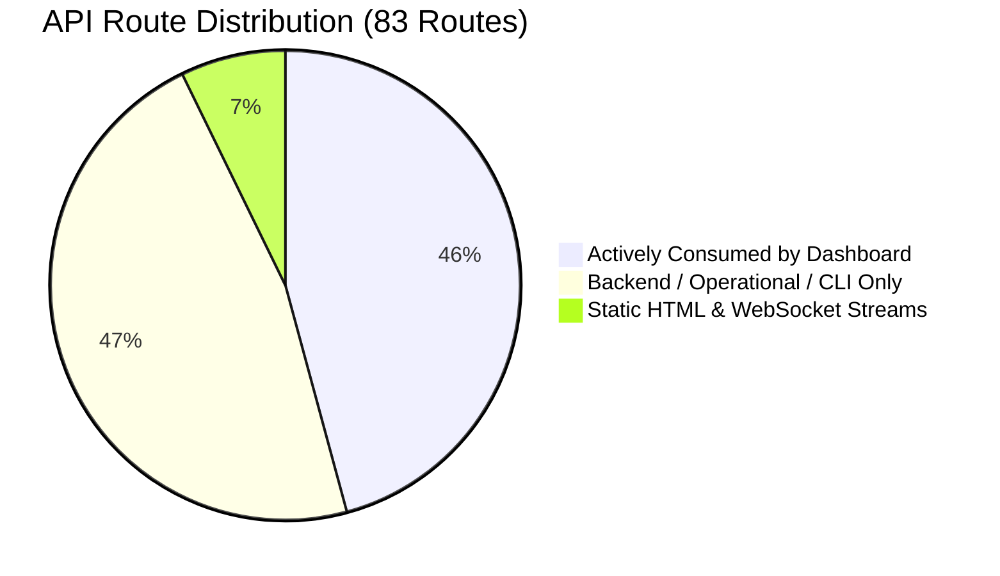

# Phase 1: Architecture, Code Quality & Discovery Audit

**Audit Status:** Completed  
**System Evaluated:** AI-Powered Trading Intelligence, Market Analysis & Paper Trading Platform  
**Target Architecture:** FastAPI + In-Memory Caches + SQLite/PostgreSQL + Modular Agent Intelligence + Vanilla JS / React Dashboard  
**Date:** November 1, 2026  
**Auditor:** Antigravity (System Architect & Senior Software Engineer)

---

## 1. Executive Summary & System Topology

The platform is designed as an event-driven, multi-asset (NSE Equities, Crypto, Forex) trading intelligence and paper trading execution system. It is structured around modular agents covering data ingestion, feature extraction, macro/sentiment scoring, AI ensemble prediction, risk gating, and simulated order execution.

### High-Level Architectural Flow



### Runtime Entry Points

The codebase provides several entry points depending on host capability and operational mode:

| Entry Point | Primary Purpose | Runtime Profile | Dependencies |
|---|---|---|---|
| `server.py` (`api/app.py`) | **Production Web & API Server** | FastAPI ASGI app running under Uvicorn (`port 8000`). Mounts all 83 endpoints, static dashboard files, background refresh loops, and health endpoints. Includes a degraded fallback mode on import failure. | Core API, SQLite/PostgreSQL, ML ensemble, background workers. |
| `swing_server.py` | **Lightweight Local Server** | Monolithic, CPU-optimized server designed for low-spec PCs. Runs strictly Swing and Intraday endpoints while disabling ML ensemble, background market loops, and Telegram alerts. | Minimal dependencies, local SQLite. |
| `autonomous_runner.py` | **Event-Driven Headless Runner** | Production daemon with Binance WebSocket, CCXT fallback, data gap filling, regime change alerts, and automated paper trade triggering. | Headless CLI / daemon mode. |
| `live_runner.py` / `async_runner.py` | **Periodic Batch Runners** | Synchronous and asynchronous cycle runners that fetch 5-minute bars, run predictions, log signals, and sleep. | Batch execution. |
| `main.py` | **Pipeline Bootstrap** | Minimal orchestration script that initializes the database and triggers ingestion + indicator pipelines across configured symbols. | CLI utility. |
| `scripts/nightly_swing_scan.py` | **Scheduled Nightly Scanner** | Batch scanner executed post-market (e.g. 19:00 IST) to screen 60+ NSE symbols, filter setups, and persist the next day's SwingSpectrum shortlist. | Background cron / batch CLI. |

---

## 2. Component & Directory Inventory

The repository is modularly organized across 10 functional top-level packages:

```
e:\trading\
├── agents/                  # 12 Modular Intelligence & Execution subpackages (270 files)
│   ├── ai_engine/           # XGBoost, LightGBM, LSTM, Fallback models, Trainer
│   ├── alerts/              # Telegram alert handlers
│   ├── analytics/           # Feedback loop, Signal tracker, Trade journal
│   ├── backtester/          # Walk-forward testing, Ensemble validator, Backtest engine
│   ├── data_ingestion/      # NSE, Binance, DexScreener, Forex, Context & Sentiment fetchers
│   ├── execution/           # Paper trading engine, Position sizing, Trailing SL
│   ├── feature_engine/      # Indicators, Multi-timeframe scorer, Regime detector
│   ├── intraday_engine/     # 5m scanner, ORB/VWAP/CPR strategies, Intraday risk manager
│   ├── macro/               # COT fetcher/scorer, Macro heatmap, Edge engine, Seasonality
│   ├── market_intelligence/ # Swing scanner, Breakout scanner, Index mover, Forex scanner
│   ├── notifications/       # Multi-channel notification dispatchers
│   └── signal_engine/       # Signal generator, Quality scorer
├── api/                     # FastAPI application factory, routes, and service layer (10 files)
│   ├── app.py               # Lifespan context, background task scheduler, CORS, static mount
│   ├── paths.py             # Root path resolution for static assets and models
│   ├── routes.py            # 83 route declarations across 38 resource prefixes
│   └── service.py           # Shared in-memory caches, background loops, business logic
├── config/                  # Configuration, logging, and environment management (5 files)
│   ├── logger.py            # Centralized logging setup
│   ├── settings.py          # Master system configuration, symbol lists, risk caps, forex windows
│   └── learned_weights.json # Calibrated signal weights from analytics feedback loop
├── dashboard/               # Active Web Frontend (Vanilla JS + HTML + CSS) (7 files)
│   ├── index.html           # Main multi-tab application UI (2355 lines)
│   ├── app.js               # Frontend controller, REST fetchers, WebSocket client (5222 lines)
│   ├── styles.css           # Custom dark/light theme CSS design system
│   ├── crypto.html          # Specialized Crypto & Meme coin dashboard
│   └── landing.html         # Public marketing landing page
├── db/                      # Database persistence layer (SQLAlchemy ORM) (19 files)
│   ├── connection.py        # Engine factory (SQLite default, PostgreSQL via DATABASE_URL)
│   ├── models.py            # 14 SQLAlchemy ORM tables
│   ├── swing_store.py       # Swing scan snapshots and multi-day setup persistence
│   ├── swing_outcome_tracker.py # Lifecycle evaluator (WATCHLIST -> TRIGGERED -> FILLED -> CLOSED)
│   ├── intraday_store.py    # Intraday scan persistence
│   └── ohlcv_cache.py       # In-database candlestick cache
├── risk/                    # Risk management rules & circuit breakers (4 files)
│   └── swing_risk.py        # Swing-specific R:R, position sizing, and exposure caps
├── scripts/                 # Utility, batch, and test scripts (26 files)
│   ├── backtester.py        # Strategy backtesting CLI
│   ├── nightly_swing_scan.py# Nightly SwingSpectrum runner
│   ├── ranking_engine.py    # Symbol ranking and scoring engine
│   └── debug/               # 15 Development/troubleshooting scratch scripts
├── tests/                   # Automated unit and integration test suite (49 files)
│   └── test_*.py            # 383 passing tests covering models, math, endpoints, and stores
├── tradvix-app/             # Prototype Vite + React 19 Frontend (4318 files)
│   ├── src/                 # Standard boilerplate Vite starter (not actively wired to backend)
│   └── package.json         # React 19, Vite 6, ESLint 9
└── utils/                   # Shared low-level utilities (3 files)
    ├── atomic_io.py         # Thread-safe atomic file writing
    └── retry.py             # Exponential backoff and retry decorators
```

---

## 3. Complete API & Route Surface Audit

The platform exposes **83 distinct routes** in `api/routes.py`:
- **1 Root Dashboard**: `GET /`
- **2 Crypto Dashboard Views**: `GET /crypto/`, `GET /crypto`
- **1 Landing Page**: `GET /landing`
- **1 Favicon Asset**: `GET /favicon.ico`
- **1 WebSocket Stream**: `WS /ws/prices`
- **77 REST API Endpoints**: `/api/*`

### Route Utilization Breakdown



#### A. Actively Consumed by Frontend Dashboard (38 Endpoints)
These endpoints are continuously polled or requested on-demand by `dashboard/app.js`, `dashboard/crypto.html`, or `dashboard/landing.html`:

| HTTP Method | Route | Consuming Frontend Feature |
|---|---|---|
| `GET` | `/api/signals/all` | Overview tab signals grid and summary cards |
| `GET` | `/api/stats` | Header stats strip (Capital, P&L, Win Rate, Trades) |
| `GET` | `/api/nse/dashboard` | Market intelligence bar, Nifty/BankNifty badges |
| `GET` | `/api/overview/intelligence` | AI Decision Cockpit, market sentiment bar |
| `GET` | `/api/screener/opportunities` | Top momentum opportunities strip |
| `GET` | `/api/swing-scanner` | SwingSpectrum tab daily setups grid |
| `GET` | `/api/swing/shortlist` | Swing shortlist banner and auto-picker |
| `GET` | `/api/intraday/latest` | Intraday tab live setups and strategy badges |
| `POST` | `/api/intraday/scan` | Intraday "Scan Now" manual trigger |
| `POST` | `/api/paper/trade` | Modal / Card "Paper Trade" execution button |
| `GET` | `/api/paper/scorecard` | Paper trading scorecard banner |
| `POST` | `/api/paper/resolve` | EOD paper trade auto-resolution button |
| `GET` | `/api/portfolio` | Portfolio tab open positions & balance breakdown |
| `GET` | `/api/performance` | Performance tab equity curve & closed trades table |
| `GET` | `/api/market/{symbol}` | Quick quote modal detailed metrics |
| `GET` | `/api/signal/{symbol}` | Single symbol signal lookup |
| `GET` | `/api/search/symbols` | Universal search bar auto-complete |
| `GET` | `/api/search/quote/{symbol}` | Universal search bar quote fetcher |
| `GET` | `/api/index-mover/{index_name}`| Index Mover tab contribution bar chart |
| `GET` | `/api/breakouts` | Breakouts tab 52-week & intraday breakout table |
| `GET` | `/api/sectors` | Sectors heatmap grid |
| `GET` | `/api/screener/gainers` | Top gainers screener list |
| `GET` | `/api/screener/losers` | Top losers screener list |
| `GET` | `/api/tradeflow` | FII / DII institutional net flow tracker |
| `GET` | `/api/analytics/scorecard` | Strategy scorecard tab |
| `GET` | `/api/learning/stats` | Self-learning engine weights & accuracy tab |
| `GET` | `/api/learning/outcomes` | Historical signal calibration outcomes |
| `GET` | `/api/crypto/meme` | Crypto dashboard meme coin radar table |
| `GET` | `/api/crypto/intelligence` | Crypto market sentiment & regime cards |
| `GET` | `/api/crypto/news` | Crypto RSS news feed |
| `GET` | `/api/crypto/prediction` | Crypto directional forecast pills |
| `GET` | `/api/context/events` | Economic calendar & news feed strip |
| `GET` | `/api/context/market-mood` | Composite sentiment gauge |
| `GET` | `/api/context/{symbol}` | Detailed news sentiment breakdown modal |
| `GET` | `/api/morning-scan` | Morning pre-market scan results |
| `GET` | `/api/trades` | Historical trade journal view |
| `GET` | `/api/backtest/{symbol}` | Interactive backtest runner modal |
| `POST` | `/api/refresh` | Force global market data cache invalidation |

#### B. Backend / Operational / CLI Only Endpoints (39 Endpoints)
These endpoints exist on the server but are not currently wired to buttons in `dashboard/app.js`:

| Category | Endpoints | Purpose |
|---|---|---|
| **Health & Diagnostics** | `/api/health` | Uptime check, Render keep-alive, dependency status |
| **Forex Paper Module** | `/api/forex/rates`, `/api/forex/signals`, `/api/forex/signal/{symbol}`, `/api/forex/sessions`, `/api/forex/ohlcv/{symbol}` | Twelve Data paper-only forex scanner (available via API/CLI) |
| **Macro Edge Engine** | `/api/edge/score/{symbol:path}`, `/api/edge/top-setups`, `/api/edge/macro-heatmap`, `/api/edge/risk-gauge` | Macro COT, seasonality, and carry trade intelligence |
| **Model Operations (MLOps)** | `/api/retrain`, `/api/retrain/status`, `/api/ensemble/validate`, `/api/ensemble/status` | On-demand training triggers for XGBoost/LightGBM |
| **Risk & Circuit Breaker** | `/api/risk/state`, `/api/risk/reset-circuit` | Risk manager status inspection and manual unblocking |
| **Paper Management** | `/api/paper/open`, `/api/paper/close/{trade_id}` | Programmatic order exit and open trade inspection |
| **Swing History & Debug** | `/api/swing/history`, `/api/swing/history/{scan_id}`, `/api/swing/history/{symbol}`, `/api/swing/stats`, `/api/swing/scan-now`, `/api/swing-debug`, `/api/swing/symbol/{symbol}` | Historical setup playback, outcome analytics, per-symbol debug |
| **Telegram Notifications** | `/api/telegram/status`, `/api/telegram/test` | Bot health check and test message dispatcher |
| **Auxiliary Feeds** | `/api/signals/winrate`, `/api/signals/leaderboard`, `/api/analytics/signals`, `/api/symbols`, `/api/regime/{symbol}`, `/api/intraday/live-quote/{symbol}`, `/api/intraday/stats`, `/api/market/mood`, `/api/nlp/summary`, `/api/nse/news`, `/api/nse/prediction` | Headless CLI utilities and legacy feed endpoints |

---

## 4. Key Architectural Findings & Structural Concerns

### 1. Dual UI Surface Fragmentation (Vanilla JS vs Vite/React)
- **Current State:** The production dashboard is rendered entirely with vanilla JavaScript (`dashboard/app.js`, 5,222 lines) and semantic HTML (`dashboard/index.html`, 2,355 lines). 
- **The Issue:** `tradvix-app/` contains 4,318 files comprising a Vite + React 19 starter project created on March 3rd. It has its own CI step in `.github/workflows/ci.yml` (`npm run lint`, `npm run build`), yet none of the trading features exist in `tradvix-app/`.
- **Architectural Risk:** CI time and bandwidth are spent validating an unlinked React starter while the actual production UI is vanilla JS.
- **Recommendation:** Keep vanilla JS as the primary production dashboard until an intentional migration plan is approved. Clarify or isolate `tradvix-app` to prevent developer confusion.

### 2. Dual NSE Fetcher Modules
- **Current State:** The project intentionally maintains two `nse_fetcher.py` files:
  1. `agents/market_intelligence/nse_fetcher.py`: Lightweight fetcher tuned for fast dashboard rendering and individual symbol quotes via Yahoo Finance and NSE HTTP.
  2. `agents/data_ingestion/nse_fetcher.py`: Batch ingestion fetcher with database write capabilities.
- **Architectural Risk:** Documented in `docs/nse_fetcher_modules.md`, but requires disciplined import boundaries so callers do not inadvertently trigger batch DB writes during live API requests.

### 3. Risk Management Fragmentation
- **Current State:** Risk management logic is dispersed across 4 different files:
  - `risk_manager.py` (project root): Legacy or top-level risk module.
  - `risk/swing_risk.py`: Dedicated swing trading R:R, position limits, and gap checks.
  - `agents/intraday_engine/risk_manager.py`: Intraday-specific max daily loss and circuit breaker.
  - `agents/execution/position_sizing.py`: Mathematical position sizing (Kelly Criterion, Fixed Fractional).
- **Architectural Risk:** Lack of a single authoritative Risk Orchestrator means intraday and swing trades could theoretically breach overall portfolio heat if tracked independently.
- **Recommendation:** Consolidate risk policy under a unified `risk/` domain where `IntradayRisk` and `SwingRisk` inherit from a common `PortfolioRiskBudget` contract.

### 4. Root Directory Clutter & State Files
- **Current State:** 10+ JSON cache files and temporary state artifacts sit directly in the project root:
  - `annual.txt` (17.7 MB uncompressed CFTC report dump).
  - `.news_cache.json.vmyooc6_.tmp` (105 KB orphan temporary file).
  - `context_cache.json` (282 KB), `trade_journal.json` (333 KB), `cot_cache.json`, `risk_cache.json`, `seasonal_cache.json`.
- **Architectural Risk:** Root-level cache files create race conditions across multiple worker processes, risk accidental commits into git, and make server cold-starts non-deterministic.
- **Recommendation:** Relocate all state files into `data/cache/` or store them directly inside SQLite/PostgreSQL. Add `*.tmp` and `annual.txt` to `.gitignore`.

### 5. Render Free-Tier Operational Constraints
- **Blueprint Profile (`render.yaml`):**
  - Runs `uvicorn server:app` on a free web service.
  - Pinned thread caps (`OMP_NUM_THREADS=1`, `OPENBLAS_NUM_THREADS=1`, `MKL_NUM_THREADS=1`, `NUMEXPR_NUM_THREADS=1`) successfully prevent BLAS thread spawning and memory spikes.
  - Pinned `xgboost>=2.0.0,<2.1.0` avoids pip pulling the massive `nvidia-nccl-cu12` GPU package.
- **Persistence Limitation:** The free plan does not support persistent attached disks. All SQLite transactions (`trading.db`) are ephemeral and reset upon container sleep or redeployment unless `DATABASE_URL` is configured to an external PostgreSQL instance.

---

## 5. Dependency Audit

### Python Dependencies (`requirements.txt`)
All 21 dependencies were verified against Python 3.12 compatibility:

| Package | Pinned Constraint | Architectural Role | License | Security / Memory Posture |
|---|---|---|---|---|
| `pandas` | `>=2.0.0` | Time series & DataFrame manipulation | BSD-3 | High memory during multi-year bar calculations; kept in check by slicing. |
| `numpy` | `>=1.24.0` | Numerical calculations | BSD-3 | Thread-limited via `render.yaml`. |
| `fastapi` | `>=0.110.0` | Asynchronous REST and WebSocket framework | MIT | Robust, async-native. |
| `uvicorn` | `>=0.27.0` | ASGI server | BSD-3 | Low overhead. |
| `httpx` | `>=0.27.0` | Asynchronous HTTP client (self-ping, external APIs) | BSD-3 | Modern connection-pooling client. |
| `sqlalchemy` | `>=2.0.0` | ORM & database abstraction | MIT | 2.0 type-safe syntax used. |
| `alembic` | `>=1.13.0` | Schema migrations | MIT | Migration scripts configured. |
| `ccxt` | `>=4.0.0` | Crypto exchange unification (Binance) | MIT | Keyless public market data. |
| `yfinance` | `>=0.2.30` | NSE historical bar fallback | Apache-2.0 | Public HTTP; rate-limit prone if unthrottled. |
| `nsepython` | `>=2.0.0` | NSE India public scraping utility | MIT | Fragile during NSE website updates; requires fallback guards. |
| `xgboost` | `>=2.0.0,<2.1.0` | Gradient boosting model (Signals) | Apache-2.0 | Pinned `<2.1.0` to avoid Linux CUDA wheel bloat. |
| `scikit-learn`| `>=1.4.0` | Fallback predictor & feature scaling | BSD-3 | Standard statistical stack. |
| `pytest` | `>=8.0.0` | Automated testing framework | MIT | Dev dependency. |

---

## 6. Dead Code & Redundancy Register

During this audit, the following files were flagged for archiving, cleanup, or consolidation:

1. **`annual.txt` (17.7 MB, Root):** Raw CFTC data dump left in the root directory. Should be moved to `data/` or deleted once ingested.
2. **`test_cot_fetcher.py.bak` (`tests/`):** Backup file left in the active test folder.
3. **`scripts/debug/` (15 scripts):** One-off test scripts (`_debug_bel.py`, `check_tickers.py`, `patch_server.py`, etc.). Should remain isolated in `scripts/debug/` and excluded from CI runs.
4. **`start_swing.bat` & `swing_server.py`:** Secondary runner duplicating route logic from `api/routes.py`. If maintained for low-spec PCs, should import handlers from `api/` rather than re-declaring in-memory logic.

---

## 7. Phase 1 Sign-Off & Next Steps

Phase 1 Architectural Discovery is complete. The system structure, entry points, 83 API routes, and dependency constraints are fully cataloged.

**Immediate Action for Phase 2:**
Proceed to **Phase 2: Backend, Database & API Contracts Audit (`docs/audit/02_BACKEND_DATABASE_AUDIT.md`)**:
- Inspect all 14 database models in `db/models.py`.
- Verify foreign keys, indexes, cascade deletes, and transaction safety.
- Audit input validation schemas across high-risk endpoints (paper trade placement, circuit reset, swing scans).
- Test database migrations and PostgreSQL cross-compatibility.
