# Phase 3: Market Data Reliability & Data Integrity Audit

**Audit Status:** Completed  
**System Evaluated:** Multi-Asset Data Ingestion Pipelines (NSE Equities, Crypto, Forex, Macro) & Validation Engine  
**Target Specifications:** Zero-cost keyless access, rate limit resilience, timestamp integrity (IST/UTC), gap filling, and latency transparency  
**Date:** November 1, 2026  
**Auditor:** Antigravity (System Architect & Senior Software Engineer)

---

## 1. Executive Summary & Data Feed Topology

The platform integrates market data across four distinct asset classes without requiring paid API keys:
1. **NSE Equities & Indices:** Real-time quotes via direct NSE HTTP with `nsepython` and `yfinance` multi-tier fallbacks.
2. **Crypto & Meme Tokens:** Real-time sub-second streaming via Binance public WebSocket with CCXT and DexScreener fallbacks.
3. **Forex Pairs (Paper Only):** Twelve Data API operating within strict free-tier limits (800 calls/day, 8 credits/min) and mapped to global trading sessions.
4. **Macro, News & Sentiment:** CFTC Commitments of Traders (COT) weekly reports, FII/DII institutional trade flows, and Google News/CryptoPanic RSS keyword sentiment.

### Data Ingestion Architecture Diagram

```mermaid
flowchart TD
    subgraph NSE_Layer ["NSE Equities & Indices Pipeline"]
        NSE_Live["Tier 1: Direct NSE HTTP (Cookies, 10s TTL)"]
        NSE_Python["Tier 2: nsepython library"]
        YF["Tier 3: yfinance fast_info (SQLite Cache)"]
        NSE_Live -->|Fail| NSE_Python
        NSE_Python -->|Fail| YF
    end

    subgraph Crypto_Layer ["Crypto & Meme Token Pipeline"]
        Binance_WS["Primary: Binance WebSocket (wss://stream.binance.com)"]
        CCXT_Poll["Fallback: CCXT REST Polling (Public)"]
        DexScreener["DexScreener API (Solana/Meme Pairs)"]
        Binance_WS -->|Disconnect (50 Retries)| CCXT_Poll
    end

    subgraph Forex_Layer ["Forex Pipeline (Paper Trading Only)"]
        TwelveData["Twelve Data Free API (8 calls/min, 800/day)"]
        Pacing["Inter-call Pacer (_MIN_CALL_GAP = 8.0s)"]
        Backoff["429 Backoff (65s auto-pause)"]
        Session["IST Session Gate (Asian, London, NY, NSE_INR)"]
        TwelveData --> Pacing --> Backoff --> Session
    end

    subgraph Macro_Layer ["Macro & Sentiment Pipeline"]
        COT["CFTC COT Reports (Weekly, 7-day TTL)"]
        RSS_NSE["Google News RSS (Public XML)"]
        RSS_Crypto["CryptoPanic / CoinDesk RSS"]
        FII_DII["NSE FII/DII Cash Trade Flows"]
    end

    subgraph Validation_Engine ["Data Integrity & Validation (validator.py)"]
        V_Gap["1. Gap Detection (Interval Check)"]
        V_Dupe["2. Duplicate Timestamps Drop"]
        V_Spike["3. 10% Spike Cap"]
        V_Stale["4. Stale Bar / Freeze Detection"]
        V_ZeroVol["5. Zero-Volume Masking"]
        V_Corp["6. Corporate Action / Split Warning"]
    end

    subgraph Persistence_Cache ["OHLCV Cache & Storage (db/ohlcv_cache.py)"]
        Cache["ohlcv_cache Table (Composite PK: symbol, timeframe, timestamp)"]
    end

    NSE_Layer --> Validation_Engine
    Crypto_Layer --> Validation_Engine
    Forex_Layer --> Validation_Engine
    Macro_Layer --> Validation_Engine
    Validation_Engine -->|is_safe = True| Persistence_Cache
```

---

## 2. Multi-Asset Provider Inventory

| Asset Class | Primary Data Provider | Protocol | Latency Profile | Credentials Required | Rate Limit Strategy | Fallback Route |
|---|---|---|---|---|---|---|
| **NSE Equities (LTP / Quote)** | Direct NSE India HTTP | REST (HTTPS) | Sub-second (during market hours) | None (Public Session Cookies) | 10-second in-memory cache | `nsepython` $\rightarrow$ `yfinance.fast_info` |
| **NSE Equities (Historical Bars)** | Yahoo Finance (`yfinance`) | REST (HTTPS) | 5–15 min delayed | None | SQLite cache, 15s timeout | Direct NSE / `nsepython` |
| **Crypto Majors (BTC, ETH, SOL)** | Binance WebSocket | WSS (`wss://stream.binance.com:9443`) | Sub-second live ticks | None (Public Stream) | Auto-reconnect with 50 retries | CCXT REST polling (`fetch_ohlcv`) |
| **Crypto Meme Tokens** | DexScreener | REST (HTTPS) | 1–3 seconds | None | 30s cache TTL | Public volume heuristic |
| **Forex Pairs** | Twelve Data | REST (HTTPS) | Real-time / 1-min delayed | Free API Key | 8.0s inter-call gap, 65s minute backoff | In-memory cached bars |
| **Macro COT Reports** | CFTC / `cot-reports` | HTTP | Weekly (Friday 15:30 EST) | None | 7-day cache TTL | Local file / cache JSON |
| **News & Sentiment** | Google News & Crypto RSS | RSS XML | 15–30 min refresh | None (Keyless RSS) | 300s cache TTL | Neutral fallback (score 50.0) |

---

## 3. Provider-by-Provider Technical Deep Dive

### A. NSE Equities & Indices Pipeline
- **Implementation:** `agents/data_ingestion/nse_live_quote.py`, `agents/market_intelligence/nse_fetcher.py`.
- **Direct Scraping Mechanism:** 
  - `NSELiveQuoteClient` maintains an active `requests.Session` with desktop Chrome headers.
  - Automatically fetches the NSE homepage (`https://www.nseindia.com`) to seed session cookies every 300 seconds (5 minutes).
  - Queries `https://www.nseindia.com/api/quote-equity?symbol=...` for equities and `/api/allIndices` for Nifty 50 and BankNifty.
- **Dynamic Relative Volume (RVOL):**
  - Adjusts expected volume dynamically based on the exact elapsed minutes within the 375-minute cash session (09:15 to 15:30 IST):
    $$\text{Expected Volume} = \text{Average Daily Volume} \times \left(\frac{\text{Elapsed Minutes}}{375}\right)$$
    $$\text{RVOL} = \frac{\text{Current Cumulative Volume}}{\text{Expected Volume}}$$
  - Prevents opening-bell volume spikes from distorting whole-day volume calculations.
- **Latency & Feed Labeling Transparency:**
  - Direct NSE quotes are live exchange snapshots during market hours.
  - Historical candlestick bars retrieved via `yfinance` for `.NS` tickers are **5 to 15 minutes delayed**. 
  - The platform transparently marks these bars as delayed (`is_delayed = True`) so simulated intraday trades do not assume sub-millisecond broker direct market access.

### B. Crypto & Meme Token Pipeline
- **Implementation:** `agents/data_ingestion/binance_ws.py`, `agents/ai_engine/meme_predictor.py`.
- **WebSocket Streaming:**
  - Streams combined `kline` streams for all active pairs (e.g. `btcusdt@kline_1h`, `ethusdt@kline_1h`).
  - Implements an exponential backoff reconnect loop that survives up to 50 network drops.
  - On WebSocket interruption, seamlessly falls back to CCXT REST polling without throwing unhandled exceptions to callers.
- **Meme Token Intelligence:**
  - DEX screening via `dexscreener_client.py` tracks DEX pool liquidity, 24h volume, and buy/sell transaction ratios.
  - Framed strictly as educational risk awareness: signals flag rug-pull indicators, low liquidity warnings, and abnormal transaction spikes.

### C. Twelve Data Forex Pipeline (Paper Trading Only)
- **Implementation:** `agents/data_ingestion/forex_fetcher.py`, `agents/market_intelligence/forex_scanner.py`.
- **Strict Product Constraint:** **Simulated Paper Trading Only — Zero live broker integration ever.**
- **Credit Budget & Pacing:**
  - Twelve Data free tier allows 800 requests/day and 8 requests/minute.
  - `_wait_for_rate_limit()` enforces an 8.0-second minimum gap between successive HTTP requests (`_MIN_CALL_GAP_SECONDS = 8.0`).
  - Total daily calls are persisted in `daily_api_usage.json`. If a 429 response is encountered, a 65-second backoff (`_minute_backoff_until`) is activated immediately.
- **Global Session Awareness (IST Windows):**
  - `FOREX_SESSIONS` maps currency sessions to Indian Standard Time:
    - *Asian Session:* 05:30 – 14:30 IST (Focus: `USD/JPY`, `AUD/USD`)
    - *London Session:* 13:30 – 22:30 IST (Focus: `EUR/USD`, `GBP/USD`)
    - *New York Session:* 18:30 – 03:30 IST (Focus: `EUR/USD`, `USD/CAD`)
    - *NSE INR Session:* 09:00 – 17:00 IST (Focus: `USD/INR`, `EUR/INR`, `GBP/INR`, `JPY/INR`)
  - INR pairs are locked outside 09:00–17:00 IST, preventing false signals when domestic cash settlement is closed.

### D. Macro, COT & Sentiment Pipeline
- **Implementation:** `agents/macro/cot_fetcher.py`, `agents/data_ingestion/context_fetcher.py`.
- **Commitments of Traders (COT):**
  - Fetches institutional positioning (Commercial vs Non-Commercial net positions) across commodities and currencies.
  - Stored in a 7-day cache; weekly Friday releases are automatically parsed without burdening daily execution cycles.
- **Keyless News & Keyword Sentiment:**
  - Google News RSS provides keyless, zero-cost headlines for NSE stocks.
  - CryptoPanic / CoinDesk RSS feeds provide crypto news.
  - Articles are categorized into **24-hour** and **7-day** windows via `pubDate` headers to measure short-term momentum vs intermediate sentiment bias.
  - Paid APIs (`MarketAux`, `RapidAPI`) remain disabled unless explicitly toggled via `CONTEXT_USE_PAID_APIS=true`.

---

## 4. Data Integrity & Validation Layer (`agents/data_ingestion/validator.py`)

Before any OHLCV DataFrame is fed into indicator calculations or signal models, it must pass the 6-stage validation suite:

```mermaid
flowchart LR
    In["Raw OHLCV DataFrame"] --> C1["1. Duplicate Timestamps Check"]
    C1 --> C2["2. Gap Detection (vs Interval)"]
    C2 --> C3["3. Spike Cap (>10% Single Bar)"]
    C3 --> C4["4. Stale Bar Freeze Check"]
    C4 --> C5["5. Zero-Volume Bar Flagging"]
    C5 --> C6["6. Corporate Action / Split Ratio (>8%)"]
    C6 --> Out["DataQualityReport (quality_pct & is_safe)"]
```



### The 6 Validation Guards:
1. **Duplicate Timestamps Drop:** Automatically removes duplicate rows, keeping the latest bar.
2. **Missing Candle Gap Detection:** Compares consecutive timestamps against expected interval delta (`1m`, `5m`, `15m`, `1h`, `1d`). Flags excessive missing bars.
3. **Abnormal Price Spike Capping:** Single-bar price changes exceeding 10% (`_SPIKE_PCT = 10.0%`) are flagged as anomalous bad ticks and capped to the 10% maximum to prevent indicator distortion.
4. **Stale Data / Frozen Feed Detection:** Detects runs of 3 or more consecutive identical OHLCV bars (a signature of frozen WebSockets or dead feeds).
5. **Zero-Volume Bar Flagging:** Flags zero-volume bars to prevent volume indicators (OBV, MFI, VWAP) from calculating invalid values.
6. **Corporate Action Split Detection:** Compares `adj_close / close` ratio shifts. Any sudden jump $>8\%$ is flagged as a likely stock split or dividend adjustment.

### The Safety Gating Rule:
- Each failed check increments `report.bad_rows`.
- If $\frac{\text{bad\_rows}}{\text{total\_rows}} \ge 15\%$ (`_UNSAFE_BAD_RATIO = 0.15`), `report.is_safe = False`.
- **Result:** Signal generation is completely aborted for that cycle on that symbol, eliminating garbage-in-garbage-out false signals.

---

## 5. Timezone Integrity & Alignment Audit

Indian equities and global crypto operate on different calendar conventions:

| Asset Class | Market Session | Timezone Used | Storage Format | Alignment Mechanism |
|---|---|---|---|---|
| **NSE Equities** | 09:15 – 15:30 IST | `Asia/Kolkata` (UTC+5:30) | Naive UTC in DB, localized as IST | Naive timestamps are localized as IST; UTC bars are converted via `tz_convert("Asia/Kolkata")`. Verified by `TestSessionTimezones`. |
| **Forex INR Pairs** | 09:00 – 17:00 IST | `Asia/Kolkata` (UTC+5:30) | Naive UTC | Session gates active only during domestic cash hours. |
| **Crypto Pairs** | 24/7/365 | `UTC` (+00:00) | UTC timestamp | Session features map to global volume windows (Asian 00-08 UTC, European 08-16 UTC, US 16-24 UTC). |
| **Forex Majors** | 24/5 (Mon-Fri) | `UTC` (+00:00) | UTC timestamp | Weekend gaps (Friday 22:00 UTC to Sunday 22:00 UTC) are expected and filtered. |

---

## 6. Incremental OHLCV Caching (`db/ohlcv_cache.py`)

- **Schema:**
  ```sql
  CREATE TABLE IF NOT EXISTS ohlcv_cache (
      symbol     TEXT NOT NULL,
      timeframe  TEXT NOT NULL,
      timestamp  TEXT NOT NULL,
      open       REAL,
      high       REAL,
      low        REAL,
      close      REAL,
      volume     REAL,
      source     TEXT DEFAULT 'yfinance',
      fetched_at TEXT DEFAULT CURRENT_TIMESTAMP,
      PRIMARY KEY (symbol, timeframe, timestamp)
  );
  ```
- **Incremental Querying:**
  `get_latest_timestamp(symbol, timeframe)` queries `MAX(timestamp)`. Fetchers only request new candles beyond the latest cached bar, minimizing network bandwidth and eliminating external API rate-limit exhaustion.
- **Identified Architecture Note:**
  `ohlcv_cache.py` connects directly to SQLite via `sqlite3.connect()`. When deploying to Render with `DATABASE_URL` pointing to PostgreSQL, relational data (trades, swings) will persist in PostgreSQL while `ohlcv_cache` operates on a fast local SQLite cache file. This is acceptable for read performance, but requires re-warming on container spin-up.

---

## 7. Actionable Data Reliability Roadmap

| Priority | Hardening Task | Target Location | Benefit |
|---|---|---|---|
| **High** | Relocate `annual.txt` into `data/cache/` | Project Root | Removes 17.7 MB data dump from repository root; cleans git working tree. |
| **Medium** | Cache yfinance SQLite session in `/tmp` | `agents/market_intelligence/nse_fetcher.py` | Prevents disk write collisions on read-only environments. |
| **Low** | Add automated holiday calendar sync | `agents/data_ingestion/validator.py` | Pre-emptively suppresses false gap warnings on NSE declared trading holidays. |

---

## 8. Phase 3 Sign-Off

Phase 3 Market Data Reliability & Integrity Audit is officially complete. All data providers, failover chains, rate-limit pacers, and integrity validation rules are fully cataloged and verified.

**Next Step Options:**
- **Phase 5: Risk Engine & Paper Execution Hardening (`docs/audit/05_PAPER_EXECUTION_AUDIT.md`)**:
  - Implement duplicate trade prevention (symbol in-flight lock).
  - Unify fragmented risk budgets across Swing and Intraday modules.
- **Phase 6: Frontend & Portfolio Ledger Hardening (`docs/audit/06_FRONTEND_PORTFOLIO_AUDIT.md`)**.
