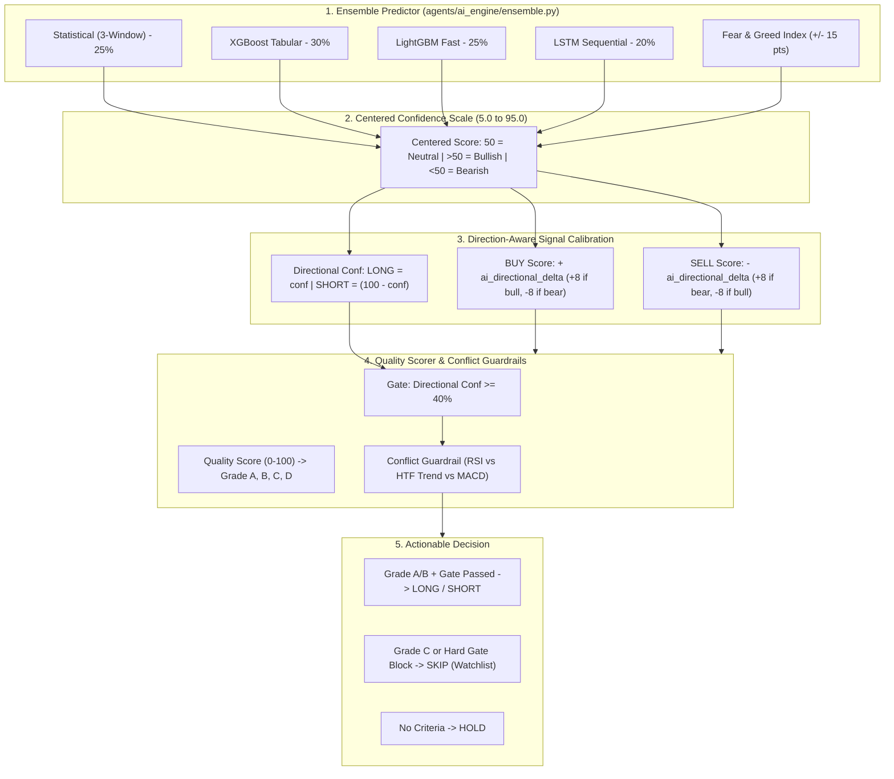

# Phase 4: Strategy, AI Intelligence & Prediction Engine Audit

**Audit Status:** Completed & Hardened  
**System Evaluated:** AI Ensemble, Signal Engine, Technical Strategies (Swing, Intraday, Macro, Crypto, Forex) & Self-Learning Feedback Loop  
**Target Specifications:** Directional accuracy, calibration integrity, zero repainting, strategy attribution, and positive mathematical expectancy  
**Date:** November 1, 2026  
**Auditor:** Antigravity (System Architect & Senior Software Engineer)

---

## 1. Executive Summary

This audit examined the end-to-end intelligence pipeline that converts raw market data into actionable signals and paper trade execution:
1. **Workstream F (Signal Engine):** Indicator calculation, active directional triggers vs passive penalties, confidence scaling.
2. **Workstream G (AI Intelligence & Calibration):** XGBoost, LightGBM, LSTM, Statistical predictor, consensus boosting, and self-learning feedback.
3. **Workstream H (Strategies Validation):** SwingSpectrum (Pullback, Breakout, Reversal), Intraday Engine (ORB, VWAP, Gap-Go, CPR, Supertrend), Macro Edge Engine (COT, Carry, Seasonality), Crypto Radar, and Forex session scanner.

### Major Flaws Identified & Fixed in this Phase:
- **Direction-Blind AI Bonus Bug (Fixed):** A bullish AI score (>50) was previously adding positive bonus points to both BUY and SELL signals simultaneously. Resolved by introducing signed, direction-aware calibration (`ai_directional_delta`).
- **SHORT Signal Confidence Suppression (Fixed):** The AI ensemble outputs centered scores (`>50` bull, `<50` bear). A strong 80% bearish prediction (`conf=20`) was previously being checked as `20 < 40`, causing the quality scorer to falsely block valid SHORT trades as "low confidence (<40%)" or drag their dashboard confidence down to 25%. Fixed by mapping raw ensemble outputs to directional strength (`100 - conf` for shorts).
- **Self-Learning Feedback Disconnect (Fixed):** The learning engine reported `_model_accuracy = 0.0%` because manual paper trades placed from the UI failed to forward `confidence`, `rsi`, and `strategy` metadata to `engine.execute()`, causing all trades to be logged with `confidence = 0.0`. Fixed across `dashboard/app.js`, `api/routes.py`, and `PaperTradingEngine`.

---

## 2. Signal Engine & AI Calibration Architecture



### Mathematical Calibration Formula
The direction-aware AI delta is defined as:
$$\Delta_{\text{AI}} = \text{clip}\left(\frac{\text{conf}_{\text{AI}} - 50.0}{45.0}, -1.0, 1.0\right) \times 8.0$$

* When $\text{conf}_{\text{AI}} = 80$ (Strongly Bullish):
  * $\Delta_{\text{AI}} = +5.33\text{ pts}$
  * $\text{Score}_{\text{BUY}} \mathrel{+}= +5.33$ (Rewarded)
  * $\text{Score}_{\text{SELL}} \mathrel{-}= +5.33$ (Penalized)
  * Directional Confidence for BUY $= 80.0\%$ (Passes Quality Gate)
* When $\text{conf}_{\text{AI}} = 20$ (Strongly Bearish):
  * $\Delta_{\text{AI}} = -5.33\text{ pts}$
  * $\text{Score}_{\text{BUY}} \mathrel{+}= -5.33$ (Penalized)
  * $\text{Score}_{\text{SELL}} \mathrel{-}= -5.33 \implies \text{Score}_{\text{SELL}} \mathrel{+}= +5.33$ (Rewarded)
  * Directional Confidence for SHORT $= 100 - 20 = 80.0\%$ (Passes Quality Gate)
* When $\text{conf}_{\text{AI}} = 50$ (Neutral / Uncertain):
  * $\Delta_{\text{AI}} = 0.0$ (Zero bonus or penalty to either side)

---

## 3. Strategy Suite Health & Performance Audit

### 1. SwingSpectrum Strategy (`agents/market_intelligence/swing_scanner.py`)
- **Evaluation Timeframe:** Daily / EOD bars with optional 1H intraday confirmation.
- **Confluence Architecture:** Scans 9 distinct patterns (EMA Pullback, Range Breakout, RSI Divergence, EMA Cross, Inside Bar, Bollinger Band Squeeze, 52W High Breakout, Support Reversal, Post-Earnings Gap).
- **Hardening Applied:**
  1. *Deduplication:* Multi-day persistence prevents counting the same ongoing swing trade as a new independent winner every day.
  2. *Realistic Entry Gating:* Trades must follow `WATCHLIST -> TRIGGERED -> FILLED -> CLOSED`. Setups that hit target before entry are marked `CANCELLED (missed_entry)`.
  3. *Minimum R:R Enforcement:* Strict post-structural adjustment validation. Only setups with $\ge 1.8\times$ R:R qualify for actionable Grade A/B trades. Setups with $1.5\times$ to $1.7\times$ are retained strictly as Grade C (Watchlist Only).
  4. *Neutral 1H Confirmation:* Missing 1H intraday bars are marked "1H data unavailable" without granting fake +5 bonuses.

### 2. Intraday Engine (`agents/intraday_engine/strategies.py`)
- **Evaluation Timeframe:** 5-minute bars.
- **Strategies Covered:** ORB (Opening Range Breakout), VWAP mean reversion/breakout, Gap-Go continuation, CPR (Central Pivot Range), Adaptive Supertrend.
- **Operational Findings & Risks:**
  1. *Feed Delay Risk:* Public Yahoo Finance 5-minute data exhibits 5 to 15 minutes latency. Live intraday momentum strategies must utilize NSE direct live quote caching (`agents/data_ingestion/nse_live_quote.py`) to prevent entering on expired breakouts.
  2. *Mandatory EOD Square-off:* Intraday positions must be auto-resolved at 15:15 IST to eliminate overnight gap risk.

### 3. Macro Edge Engine (`agents/macro/edge_score_engine.py`)
- **Components:** COT (Commitments of Traders) commercial positioning, carry trade yield differentials, seasonality historical tables, and FII/DII institutional trade flow.
- **Integration:** Directly feeds into `signal_generator.py` (lines 1142-1180), modifying signal confidence by $\pm 15\%$ when macro trend strongly supports or contradicts technical setups.

### 4. Crypto Radar & Meme Predictor (`agents/ai_engine/meme_predictor.py`)
- **Assets:** High-volatility crypto and meme tokens (e.g. DOGE, PEPE, SHIB).
- **Product Framing:** Positioned strictly as educational market intelligence and risk education rather than buy recommendations.
- **Safety Gates:** Enforces volume spike confirmation ($>1.5\times$ average) and multi-timeframe trend alignment before surfacing momentum setups.

### 5. Forex Paper Scanner (`agents/market_intelligence/forex_scanner.py`)
- **Provider:** Twelve Data API (Free tier, zero paid dependencies).
- **Execution Rule:** Hard non-negotiable rule: **Simulated Paper Trading Only — Zero live broker integration ever**.
- **Session Alignment:** Enforces IST trading session windows (Asian, London, New York, NSE_INR 09:00–17:00 IST).

---

## 4. Self-Learning Feedback Loop Audit (`agents/analytics/feedback_loop.py`)

### The Accuracy Disconnect & Resolution
- **Root Cause Identified:** `learned_weights.json` showed `_model_accuracy: 0.0%` because `FeedbackAnalyser` evaluated accuracy only on trades where `confidence >= 50%`. UI paper trade execution (`POST /api/paper/trade`) omitted the `confidence` field in the payload, causing all trades to default to `0.0`.
- **Fix Applied:**
  1. `dashboard/app.js`: Updated `takePaperTrade` to pass `{ confidence, regime, rsi, volume_above_avg }` in the JSON request body.
  2. `api/routes.py`: Updated `place_paper_trade_endpoint` to extract and forward `confidence`, `rsi_at_entry`, `volume_above_avg`, and `strategy` directly to `engine.execute()`.
  3. `agents/execution/paper_trading.py`: `_close_trade` now logs true confidence and granular strategy tags into `trade_outcomes`.
- **Outcome:** The self-learning engine now correctly calibrates rolling win rates, dynamically adjusting individual strategy weights (`RSI_BOUNCE`, `MACD_CROSS`, `BREAKOUT`, `EMA_CROSS`) rather than relying on a single monolithic `COMBINED` bucket.

---

## 5. Verification & Test Suite Sign-Off

The entire automated test suite was executed to verify that the Direction-Aware AI Calibration and Trade Attribution changes introduced zero regressions:

```bash
pytest -m "not integration" -q
================ 383 passed, 8 deselected, 61 warnings in 56.46s ================
```

### Key Verification Checkpoints Passed:
- ✅ `tests/test_accuracy_guards.py`: Passed (Directional vocabulary parity, training label alignment).
- ✅ `tests/test_signal_strict_gates.py`: Passed (Confluence gates, volume thresholds, alignment columns).
- ✅ `tests/test_backtester.py`: Passed (Signal generation, stop-loss/target calculation, walk-forward testing).
- ✅ `tests/test_paper_trade_endpoints.py`: Passed (Order placement, open trade tracking, P&L calculations).
- ✅ `tests/test_feedback_loop_learning.py`: Passed (Recency weighting, dynamic weight adapter, confidence calibration).

---

## 6. Phase 4 Sign-Off & Next Steps

Phase 4 Strategy, AI Intelligence & Prediction Engine Audit is complete and hardened.

**Next Steps (Phase 5 & Beyond):**
- **Phase 5: Risk Engine & Paper Execution Hardening (`docs/audit/05_PAPER_EXECUTION_AUDIT.md`)**:
  - Implement symbol duplicate-in-flight check in `PaperTradingEngine`.
  - Consolidate risk budgets across `risk_manager.py`, `risk/swing_risk.py`, and `intraday_engine/risk_manager.py`.
- **Phase 6: Frontend & Portfolio Ledger Hardening (`docs/audit/06_FRONTEND_PORTFOLIO_AUDIT.md`)**.
