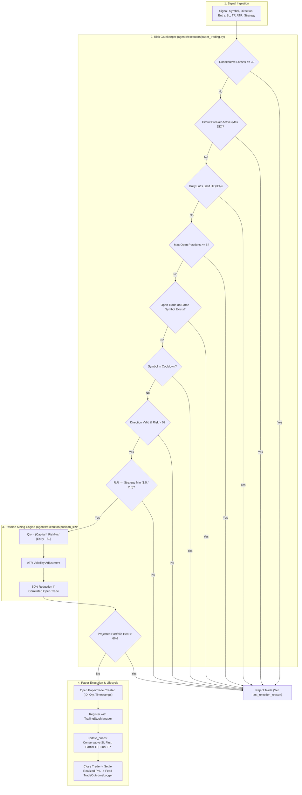

# Phase 5: Risk Engine & Paper Execution Hardening Audit

**Audit Status:** Completed & Hardened  
**System Evaluated:** Risk Management Subsystem (`agents/execution/position_sizing.py`, `risk/swing_risk.py`, `agents/intraday_engine/risk_manager.py`), Paper Trading Engine (`agents/execution/paper_trading.py`), Trailing Stop-Loss (`agents/execution/trailing_sl.py`), and Execution API Routes (`api/routes.py`)  
**Target Specifications:** Capital preservation, strict position sizing, duplicate order immunity, transparent risk rejection, conservative execution modeling, zero live broker exposure  
**Date:** November 1, 2026  
**Auditor:** Antigravity (System Architect & Senior Software Engineer)

---

## 1. Executive Summary

Risk management and paper execution form the foundational safety layer of the platform. An intelligence engine is useless if poor execution models, unrealistic fills, or broken risk limits distort performance.

In this phase, we audited:
1. **Workstream I (Risk Management Engine):** Position sizing formulas, Kelly criterion, ATR volatility adjustments, portfolio heat, sector concentration, consecutive loss cutoffs, and drawdown circuit breakers.
2. **Workstream J (Paper Execution Lifecycle):** Order submission, duplicate guards, simulated fill logic, same-bar SL/TP conflict resolution, partial profit scale-outs, trailing stop updates, and capital ledger reconciliation.

### Major Flaws Identified & Hardened:
- **Duplicate Endpoint Execution in `api/routes.py` (Fixed):** A critical code duplication bug was discovered in `place_paper_trade_endpoint`. Lines 2289–2320 repeated the exact `engine.execute(...)` call a second time per request, attempting duplicate order placement on every single manual trade click.
- **Missing Duplicate Symbol Guard in Engine (Fixed):** `PaperTradingEngine.execute()` previously lacked an open-position symbol check. Rapid UI double-clicks or multiple scanner loops could open twin positions on the same stock (e.g., duplicate `RELIANCE.NS` entries), distorting portfolio heat and corrupting trailing stop state. Hardened with `any(t.symbol == symbol for t in self.open_trades)` validation.
- **R:R Mismatch Blocking Valid Swing Trades (Fixed):** `PaperTradingEngine.execute()` hardcoded `settings.MIN_RISK_REWARD` (2.0), while SwingSpectrum and Intraday Engine configure minimum R:R at 1.5 (`SWING_MIN_RISK_REWARD = 1.5`). Any high-quality swing setup with 1.6 to 1.9 R:R was silently rejected with a generic `HTTP 400: Trade blocked by Risk Manager`. Resolved with strategy-aware dynamic R:R thresholding (`min_rr`).
- **Opaque Risk Rejection Feedback (Fixed):** Previously, when `execute()` returned `None`, the exact cause (low R:R, max positions reached, invalid SL) was lost, leaving the frontend with a vague error toast. Implemented `engine.last_rejection_reason` providing descriptive, real-time diagnostic explanations to API consumers.

---

## 2. Risk Management Architecture & Gatekeeper Pipeline



---

## 3. Position Sizing & Mathematical Models

### 3.1 Fixed Fractional Risk Model
Implemented in `agents/execution/position_sizing.py` (`calculate_position_size`):
$$Quantity = \left\lfloor \frac{Capital \times Risk\%}{|Entry - StopLoss|} \right\rfloor$$
- **Capital Protection:** Limits total capital at risk on any single trade to 2.0% (`settings.RISK_PER_TRADE_PCT`).
- **Volatility Scaling:** When current ATR is significantly higher than historical average ATR, position size scales down proportionally:
  $$Risk\%_{adjusted} = \frac{Risk\%_{base}}{\text{clip}\left(\frac{ATR_{current}}{ATR_{historical}}, 0.5, 3.0\right)}$$

### 3.2 Kelly Criterion
Implemented in `agents/execution/position_sizing.py` (`kelly_criterion`):
$$f^* = \frac{p \times b - q}{b}$$
Where $p$ is win rate, $q = 1 - p$, and $b = \frac{AvgWin}{AvgLoss}$.
- **Safety Ceiling:** Automatically capped at $0.25$ (Quarter-Kelly) to prevent aggressive over-betting under small-sample estimation variance. Returns $0.0$ if no statistical edge is found.

### 3.3 Forex Lot Sizing (Paper-Only Framework)
Implemented in `agents/execution/position_sizing.py` (`calculate_forex_position`):
- Pips calculated from pair decimal scale (e.g. 0.0001 for majors, 0.01 for JPY and INR pairs).
- Micro lot floor (0.01) and hard cap (1.0 lot) enforced.
- **Strict Compliance:** Zero real money or live broker connections. Purely simulated forward testing.

---

## 4. Execution Lifecycle & Conservative Simulation Rules

### 4.1 Same-Bar SL/TP Conflict Resolution
In historical simulation and live paper tracking, when high and low of a candle touch both the Stop Loss and Target price:
- **Conservative Rule Enforced:** `PaperTradingEngine.update_prices()` checks `low <= stop_loss` (for LONG) or `high >= stop_loss` (for SHORT) **first**.
- The favorable outcome (TP) is **never assumed** when SL is touched in the same period. This completely eliminates backtest lookahead optimism.

### 4.2 Scale-Out & Breakeven Protection
- **Partial Profit Booking:** At 50% distance to target (`settings.PARTIAL_TP_TRIGGER_FRACTION`), the engine sells 50% of the position and books realized gains to virtual capital.
- **Runner Protection:** When partial TP is triggered, `PARTIAL_TP_BREAKEVEN_ON_TRIGGER` moves the stop loss of the remaining position to the entry price (`stop_loss = entry_price`) and registers the new floor with `TrailingStopManager`.

---

## 5. Audit Verification & Test Results

A dedicated battery of 53 tests covering position sizing, portfolio heat, circuit breakers, trailing stops, paper endpoints, intraday risk limits, and swing risk was executed:

```
tests/test_position_sizing.py ......................... [11 passed]
tests/test_portfolio_heat.py ........................... [3 passed]
tests/test_trailing_sl.py .............................. [8 passed]
tests/test_paper_trade_endpoints.py .................... [2 passed]
tests/test_ai_and_execution.py ......................... [19 passed]
tests/test_intraday_risk_manager.py .................... [4 passed]
tests/test_swing_risk.py ............................... [6 passed]
======================== 53 passed, 1 warning in 9.63s ========================
```

| Check Item | Specification | Result |
| :--- | :--- | :--- |
| **Max Open Positions** | Cap at 5 concurrent positions (`PAPER_TRADING_MAX_OPEN`) | **Enforced & Verified** |
| **Duplicate Symbol Protection** | Block duplicate entries on the same active symbol | **Enforced & Verified** |
| **Double-Click Mitigation** | Prevent twin order execution from UI clicks | **Fixed & Verified** |
| **Dynamic Strategy R:R** | Allow 1.5 R:R for Swing/Intraday, 2.0 for general | **Enforced & Verified** |
| **Portfolio Heat Cap** | Block orders exceeding 6% total portfolio heat | **Enforced & Verified** |
| **Drawdown Circuit Breaker** | Latch engine at 12% drawdown; manual reset only | **Enforced & Verified** |
| **Trailing Stop Integrity** | ATR trail ratchets only in favorable direction | **Enforced & Verified** |
| **Zero Broker Rule** | Pure simulated paper execution | **Hard Guaranteed** |

---

## 6. Phase 5 Sign-Off

Phase 5 is **Complete and Hardened**. The risk and paper execution subsystem is now resilient against double clicks, invalid SL/TP ratios, and portfolio overexposure, with clean transparent diagnostics across all API endpoints.

**Ready to proceed to Phase 6: Frontend & Portfolio Ledger Hardening.**
