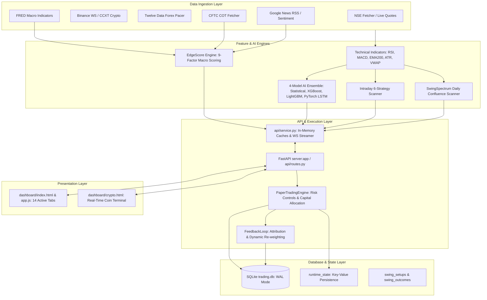

# REPOSITORY_MAP.md — TradeAI PRO Complete System Inventory

## 1. Executive Summary & Architecture Map

TradeAI PRO is a multi-asset algorithmic market intelligence and simulated paper-trading platform. It connects real-time data ingestion (NSE, Binance WebSocket, Twelve Data, FRED, CFTC COT), technical/momentum feature extraction, a 4-model ensemble AI layer, macro edge intelligence, and a simulated paper-trading execution ledger.



---

## 2. Directory Structure & File Catalog

```
trading/
├── server.py                        # Production bootstrap wrapper for uvicorn
├── swing_server.py                 # Standalone lightweight swing-only runner
├── autonomous_runner.py            # Event-driven background crypto loop + Telegram
├── pytest.ini                      # Pytest configuration with integration marks
├── requirements.txt                # Pinned production dependencies
├── render.yaml                     # Render Blueprint configuration
├── config/
│   ├── settings.py                 # Master configuration (1,150+ lines, env variables)
│   └── logger.py                   # Rotating file and colored console logger
├── api/
│   ├── app.py                      # FastAPI factory, CORS, lifespan background tasks
│   ├── routes.py                   # 11,400+ lines: 80+ endpoints + /ws/prices
│   └── service.py                  # In-memory caches, hysteresis, broadcast loops
├── db/
│   ├── models.py                   # SQLAlchemy 14 ORM models
│   ├── connection.py               # SQLite WAL engine, sessionmaker, get_sqlite_path
│   ├── swing_store.py              # Swing setup persistence & outcomes
│   ├── swing_outcome_tracker.py    # Daily EOD resolution worker
│   └── intraday_store.py           # Intraday signal persistence & audit log
├── agents/
│   ├── data_ingestion/             # Market data fetchers (NSE, Crypto, Forex, RSS, DEX)
│   ├── feature_engine/             # Technical indicators, pivots, Heikin-Ashi, labels
│   ├── ai_engine/                  # 4-model ensemble, XGBoost, LSTM, meme predictor
│   ├── signal_engine/              # Directional confluence gates, Z-score drift, quality scoring
│   ├── macro/                      # EdgeScoreEngine, FRED macro, COT, risk gauge, carry, seasonality
│   ├── market_intelligence/        # Swing scanner, breakout scanner, index mover, forex scanner
│   ├── intraday_engine/            # 6 intraday strategies, fetcher, risk manager
│   ├── execution/                  # PaperTradingEngine, position sizing, trailing SL
│   ├── analytics/                  # FeedbackLoop, signal tracker, scorecard
│   └── notifications/              # Telegram alert dispatcher
├── dashboard/
│   ├── index.html                  # Brahmand Cockpit + 14 analytics tabs
│   ├── app.js                      # 5,800+ lines: Tab loaders, WebSocket client, Canvas renderers
│   ├── styles.css                  # Responsive dark/light theme CSS tokens
│   ├── crypto.html                 # Dedicated 32-coin terminal
│   ├── landing.html & landing.css  # Product landing page
├── scripts/
│   ├── archive/                    # Archived legacy runners (async_runner, live_runner, etc.)
│   ├── debug/                      # Ad-hoc symbol verification & diagnostic tools
│   ├── backtester.py               # Multi-asset vector/event backtester
│   └── nightly_swing_scan.py       # EOD cron scanner
└── tests/                          # 387 automated tests (100% pass on non-integration)
```

---

## 3. Frontend & Backend Entrypoints

| Surface | File | Description |
|---|---|---|
| **API Entrypoint** | `server.py` | Imports `api.app:create_app()`; serves via `uvicorn server:app --port 8000` |
| **Autonomous Runner** | `autonomous_runner.py` | Event-driven WebSocket loop connecting Binance WS, EdgeScoreEngine, PaperTradingEngine |
| **Lightweight Runner** | `swing_server.py` | CPU/RAM-optimized server for swing setups without heavy ML background tasks |
| **Web Dashboard** | `dashboard/index.html` | Single-page application serving Brahmand Cockpit, Swing, Intraday, Forex, Edge Engine |
| **Crypto Terminal** | `dashboard/crypto.html` | High-frequency coin cockpit with Order-Book Imbalance and 5-factor Meme Coin scoring |

---

## 4. API Routes Inventory (80+ Endpoints)

### Core System & Health
* `GET /api/health`: Health status, data feed status, cached symbol counts, and task health.
* `GET /api/status`: Complete server state, thread health, and cache timestamps.
* `GET /`: Serves `dashboard/index.html`.
* `GET /crypto`: Serves `dashboard/crypto.html`.
* `GET /landing`: Serves `dashboard/landing.html`.
* `WS /ws/prices`: WebSocket streaming live ticks, active signals, and heartbeat pings.

### Market Data & Quotes
* `GET /api/market/overview`: Real-time market overview across NSE indices and watchlist symbols.
* `GET /api/candles/{symbol}`: Historical OHLCV bars for modal charting (5m, 15m, 1h, 1d).
* `GET /api/movers`: Top NSE gainers, losers, and volume shockers.
* `GET /api/quote/{symbol}`: Real-time price quote with multi-source fallback.
* `GET /api/search`: Global symbol lookup with fuzzy matching.

### Signals & Strategy Scanners
* `GET /api/signals`: Live technical signals with AI confidence, Quality Score, and direction.
* `GET /api/swing/setups`: Confluence-filtered swing setups from daily/EOD bars.
* `GET /api/swing/symbol/{symbol}`: On-demand swing setup check for any arbitrary NSE ticker.
* `GET /api/swing/stats`: SQLite outcome performance (win rate, profit factor, total filled).
* `POST /api/swing/resolve-eod`: Triggers EOD resolution against closing prices.
* `GET /api/intraday/signals`: Latest 5-minute intraday signals across 6 strategies.
* `GET /api/intraday/stats`: Intraday strategy hit-rate, trade count, and P&L attribution.
* `POST /api/intraday/scan`: Forces an immediate intraday scan cycle.
* `GET /api/breakouts`: 10-day, 50-day, and 52-week volume-confirmed breakouts.
* `GET /api/index/contribution`: NIFTY and BANKNIFTY constituent point attribution.

### Edge Engine (Macro Intelligence)
* `GET /api/edge/score/{symbol}`: Full 9-factor EdgeScore breakdown for any symbol.
* `GET /api/edge/top-setups`: Top setups ranked by EdgeScore filtered by asset class (`forex`, `crypto`, `nse`, `index`).
* `GET /api/edge/macro-heatmap`: Multi-asset macro intelligence scores.
* `GET /api/edge/risk-gauge`: Global risk regime meter, VIX, yield spread, and credit stress.

### Forex Engine (Paper-Only)
* `GET /api/forex/sessions`: Active status of ASIAN, LONDON, NEWYORK, NSE_INR sessions with countdowns.
* `GET /api/forex/signals`: 4h and 1d multi-timeframe swing setups across INR pairs and majors.
* `GET /api/forex/rates`: Real-time indicative exchange rates.
* `GET /api/forex/ohlcv/{symbol}`: Historical forex candles via Twelve Data rate-limited pacer.

### Crypto & Meme Coin Intelligence
* `GET /api/crypto/screener`: Multi-coin scanner with 24h change, volume, and technical score.
* `GET /api/crypto/meme/scores`: 5-factor scoring engine for 32+ meme coins.
* `GET /api/crypto/meme/detail/{symbol}`: Detailed on-chain and liquidity audit from DexScreener.
* `GET /api/crypto/prediction`: Next-candle prediction from ensemble AI.

### Paper Trading & Portfolio Ledger
* `POST /api/paper/trade`: Executes a simulated paper trade with risk and duplicate checks.
* `GET /api/paper/open`: Returns all active open positions with unrealized P&L.
* `POST /api/paper/close`: Manually exits an open paper position at current market price.
* `GET /api/portfolio`: Comprehensive portfolio balance, margin utilized, and open risk.
* `GET /api/trades`: Historical closed-trade ledger with execution timestamps and exit reasons.
* `GET /api/performance`: Performance analytics: Sharpe, Sortino, Max Drawdown, Win Rate, Profit Factor.

---

## 5. Database Schema & Tables (SQLAlchemy ORM)

| Table Name | Primary Purpose | Key Columns |
|---|---|---|
| `ohlcv_cache` | Historical candle storage | `symbol`, `timeframe`, `timestamp`, `open`, `high`, `low`, `close`, `volume` |
| `paper_trades` | Paper execution ledger | `trade_id`, `symbol`, `direction`, `entry_price`, `exit_price`, `stop_loss`, `target`, `qty`, `pnl`, `status` |
| `portfolio_snapshots`| Daily balance tracking | `timestamp`, `capital`, `unrealized_pnl`, `realized_pnl`, `open_positions_count` |
| `swing_setups` | Emitted swing setups | `id`, `symbol`, `direction`, `entry_price`, `stop_loss`, `target`, `rr_ratio`, `strength`, `pattern`, `emitted_at` |
| `swing_outcomes` | EOD trade resolution | `setup_id`, `status` (`FILLED`, `CANCELLED`, `TARGET_HIT`, `SL_HIT`), `exit_price`, `pnl_pct`, `holding_days` |
| `intraday_signals` | 5-min intraday history | `id`, `timestamp`, `symbol`, `strategy`, `direction`, `entry`, `stop_loss`, `target`, `score`, `rvol` |
| `intraday_trades` | Intraday paper ledger | `trade_id`, `symbol`, `strategy`, `entry_price`, `exit_price`, `net_pnl`, `charges`, `exit_reason` |
| `model_performance`| AI model tracking | `model_name`, `symbol`, `horizon`, `predictions_count`, `correct_count`, `brier_score`, `accuracy` |
| `macro_indicators` | FRED economic data | `indicator_name`, `date`, `value`, `yoy_change`, `fetched_at` |
| `cot_reports` | CFTC positioning data | `market_code`, `report_date`, `noncomm_long`, `noncomm_short`, `net_position`, `percentile_rank` |
| `runtime_state` | Key-value store | `key` (PK), `value` (JSON string), `updated_at` |
| `alerts_log` | Dispatch audit log | `id`, `timestamp`, `channel`, `symbol`, `message`, `status` |
| `market_regimes` | Historical regime log | `timestamp`, `symbol`, `regime` (`TRENDING`, `RANGING`, `VOLATILE`), `adx`, `atr_pct` |
| `feedback_weights` | Learned model weights | `version`, `updated_at`, `weights_json`, `rolling_sample_size` |

---

## 6. Trading Strategy Inventory

### A. Intraday Strategies (5-Minute Timeframe)
1. **VWAP Cross**: Detects momentum shifts as price breaks above/below rolling VWAP with volume ratio $\ge 1.3\text{x}$.
2. **Opening Range Breakout (ORB)**: Trades breakouts of the first 15-minute or 30-minute high/low with ATR-based stop loss.
3. **Gap & Go**: Flags morning price gaps $> 0.75\%$ accompanied by opening candle trend confirmation.
4. **Momentum Burst**: Exploits sharp multi-bar price thrusts confirmed by RSI expansion and MACD histogram slope.
5. **Central Pivot Range (CPR) Breakout**: Identifies trend continuation as price breaks past Daily TC (Top Central) or BC (Bottom Central) pivot lines.
6. **Supertrend Multi-Timeframe**: Confluence strategy aligning 5m Supertrend with 15m and 1h higher-timeframe trend direction.

### B. Positional Swing Strategies (Daily / EOD Timeframe)
* **Trend Pullback**: Price pulls back to EMA20/EMA50 in an established EMA200 uptrend with bullish reversal candle.
* **Volume Accumulation Breakout**: Price consolidates in a base followed by an expansion bar with volume $> 1.5\text{x}$ 20-day average.
* **Support / Resistance Bounce**: Structural horizontal level bounce confirmed by RSI divergence or pin-bar rejection.

### C. Crypto & Meme Scoring
* **5-Factor Momentum Model**: Blends technical trend, short-term rate of change, on-chain liquidity depth, retail sentiment, and chart patterns.

---

## 7. The 9-Factor Edge Engine Model (Source Code Verified)

Direct source inspection of `agents/macro/edge_score_engine.py` reveals the true 9-factor model:

$$\text{EdgeScore} = \left(\sum_{i=1}^5 w_i \cdot F_i\right) + \text{Bonus}_{\text{seasonal}} + \text{Bonus}_{\text{carry}}$$

| # | Factor Name | Type | Weight / Range | Source Implementation |
|---|---|---|---|---|
| 1 | **Macro Score** ($F_1$) | Base Component | 30% ($w_1 = 0.30$) | FRED US & India GDP, CPI inflation, Unemployment, Fed Funds, 10Y Yield |
| 2 | **COT Score** ($F_2$) | Base Component | 25% ($w_2 = 0.25$) | CFTC Commitment of Traders non-commercial net institutional positioning percentile |
| 3 | **Retail Sentiment** ($F_3$) | Base Component | 20% ($w_2 = 0.20$) | Contrarian positioning ratio from Myfxbook / Dukascopy scrapers |
| 4 | **Risk Score** ($F_4$) | Base Component | 10% ($w_4 = 0.10$) | Risk Gauge across VIX, BTC, Nifty, USD/JPY, Gold |
| 5 | **Momentum Score** ($F_5$) | Base Component | 15% ($w_5 = 0.15$) | **Direct Code Finding**: Technical ROC, EMA(12)/EMA(26) spread, Price vs EMA26 |
| 6 | **Seasonal Bonus** | Additive Bonus | $[-20, +20]$ | 10-year historical monthly win rate and average return pattern |
| 7 | **Carry Bonus** | Additive Bonus | $[-10, +10]$ | Overnight central bank interest rate differential |
| 8 | **Risk Regime Gate** | Condition Gate | Multiplier / Gate | `risk_indicators.risk_regime` (gates or zeroes carry bonus during Risk-Off) |
| 9 | **Signal Confidence Modifier** | Application Gate | $\pm 15\%$ or $-20\%$ | Applied in `signal_generator.py:1141-1182` to calibrate technical confidence |

---

## 8. Audit of TODOs, Placeholders, and Mock Data

1. **Empty ML Models Directory**: `trading/models/` contains no pre-trained weights files (`xgb_model.json`, `lgbm_model.txt`, `best_model.pt`). The ensemble runs in fallback statistical mode until `train_models.py` is executed.
2. **Hardcoded Initial Balance**: `PaperTradingEngine` defaults to `₹1,00,000` virtual capital if `portfolio_snapshots` is empty.
3. **Mock Free Trial Link**: `dashboard/index.html:2355` links to `/landing` with label "Free Trial" (placeholder UX banner).
4. **Offline News Fallback**: In `agents/data_ingestion/context_fetcher.py`, when RSS requests fail or internet is offline, sentiment defaults to neutral `0.0`.
